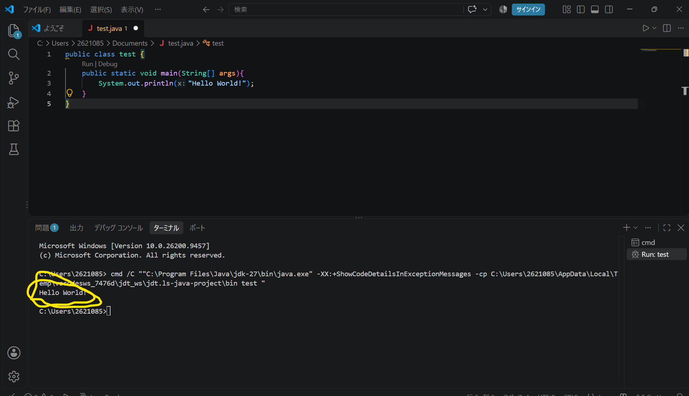

# 2. 最初のプログラム

Javaを用意しても、まだ自分のコードが動くかは確かめていません。いきなり長いプログラムを書いて動かなかったら、どこを直すかを探すのが大変です。

まずは「Hello World!」と表示するプログラムで、ファイルを保存し、実行して、結果が出ることを確かめてください。

```text
Hello World!
```

> **とりまなんか表示しておけ！おはよう世界！**

最初に表示する文字は自由です。この章は、最初の動作確認でよく使われる「Hello World!」を表示する例から始めます。

## 2-1. なぜ最初に短いプログラムを動かすの？

短いプログラムから始めると、保存・実行・表示を確かめやすくなります。何故最初が短いかと言うと、動くかもわからんのにいっぱい書いても仕方ない、ということです。

元ファイル：[test.java 全体（1〜8行）](./test.java#L1-L8)。

```java
// class testは、今回のプログラムをtestという名前でまとめる指定です。ファイル名もtest.javaにします。
public class test {
    // Javaはmainから実行を始めるため、最初に行う文字の表示をmainの中へ書きます。
    public static void main(String[] args) {
        // System.out.printlnが、括弧の中で指定した文字列を実行用ターミナルへ1行表示します。
        System.out.println("Hello World!");
    }
}
```

## 2-2. コードの解説

`class test { ... }` は、今回のプログラムを `test` という名前でまとめる指定です。`test` はこの例で付けた名前で、保存するファイル名も `test.java` にします。

Javaは `main` から実行を始めます。文字を表示する処理は、`main` の `{` と `}` の間へ書いてください。この例の `public static void main(String[] args)` は、実行を始める処理を定義するための書き方です。[test.java 1〜8行](./test.java#L1-L8)

`System.out.println("Hello World!");` は、括弧の中で指定した文字列をターミナルへ1行表示するという意味です。文字列は、プログラムが文字として扱う内容です。Javaのコードでは、文字列を半角の `"` で囲んで書いてください。[test.java 5〜6行](./test.java#L5-L6)

`System.out.println` の括弧内を `"apple"` に変更して保存・実行すると、ターミナルに `apple` と表示されます。括弧内を `"あいうえお"` に変更して保存・実行すると、ターミナルに `あいうえお` と表示されます。保存と実行は、次の「2-3. 保存して実行する」の手順で行ってください。[test.java 6行](./test.java#L6)

## 2-3. 保存して実行する

第1章でJavaを書く・動かす道具を準備してから、次の手順を行ってください。環境構築の不足する説明は、こちらで補足します。

1. Windowsのエクスプローラーで、作業用のフォルダを作ってください。フォルダ名は、たとえば `Java学習` にしてください。
2. VS Codeの **ファイル → フォルダーを開く** で、作った `Java学習` フォルダを選んでください。VS Codeの左側に作業用フォルダが表示されます。
3. VS Codeの **ファイル → 新しいテキストファイル** を選び、「2-1. なぜ最初に短いプログラムを動かすの？」に掲載した `test.java` のコード全体を入力してください。
4. Ctrl + Sを押し、作業用の `Java学習` フォルダを保存先に選んでください。ファイル名に `test.java` を入力し、**保存** を押してください。VS Codeの左側に `test.java` が表示されます。
5. VS Codeの **表示 → ターミナル** を開いてください。ターミナルの文字入力欄が画面下に表示されます。
6. エクスプローラーで `test.java` を入れた `Java学習` フォルダを開いてください。上部のアドレス欄をクリックし、Ctrl + Cでフォルダのパス（保存場所を表す文字列）をコピーしてください。
7. VS Codeのターミナルへ、次の引用符の中をコピーしたフォルダのパスに置き換えて入力し、Enterキーを押してください。Ctrl + Vでパスを貼り付けられます。ターミナルで作業する場所が、`test.java` の保存先へ変わります。

```text
cd "コピーしたJava学習フォルダのパス"
```

8. VS Codeの **表示 → ターミナル** で、保存先へ移動したターミナルを表示してください。次を入力し、Enterキーを押してください。`javac` はJavaのコードを実行できる形式へ変換する道具です。変換が成功すると、保存先に `test.class` ができます。

```text
javac -encoding UTF-8 test.java
```

`-encoding UTF-8` は、コード内の日本語をUTF-8という文字の保存形式で読む指定です。VS Codeで `test.java` を保存するときも、画面下の文字コードの表示が **UTF-8** であることを確認してください。

9. VS Codeの **表示 → ターミナル** で同じターミナルを表示してください。次を入力し、Enterキーを押してください。`java -cp . test` は、現在のフォルダにある `test` のプログラムを動かす指定です。`test` の後ろへ `.java` は付けません。

```text
java -cp . test
```

プログラムが動くと、ターミナルに次の1行が表示されます。

```text
Hello World!
```

コードの文字を変更した場合は、Ctrl + Sで `test.java` を保存し、手順8の変換と手順9の実行をもう一度行ってください。変換をやり直さずに実行すると、変更前のプログラムが動く場合があります。

次の画像は、VS Codeで `test.java` を開いて表示を確かめた例です。画像に見える `x:` はエディターの補助表示で、入力するコードには含めません。



## よくあるミス

### 行末のセミコロンを忘れる

❌ 行末の `;` がありません。

```java
System.out.println("Hello World!")
```

⭕ 行末に半角の `;` を書いてください。

```java
System.out.println("Hello World!");
```

### 括弧や引用符を全角で書く

❌ 括弧と引用符が全角です。

```java
System.out.println（”Hello World!”）;
```

⭕ 括弧と引用符を半角で書いてください。

```java
System.out.println("Hello World!");
```

### Systemの先頭を小文字で書く

❌ `system` の先頭が小文字です。

```java
system.out.println("Hello World!");
```

⭕ `System` の先頭を大文字の `S` で書いてください。

```java
System.out.println("Hello World!");
```

## 前後のページ

← [1. 環境構築](../01_環境構築/環境構築.md)

次へ → [3. コメント](../03_コメント/コメント.md)
