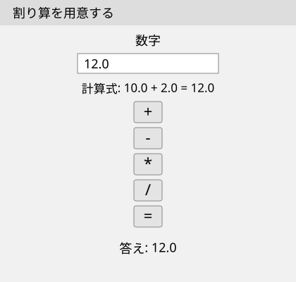
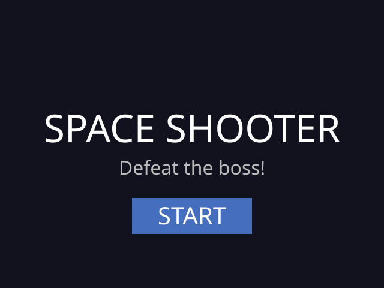
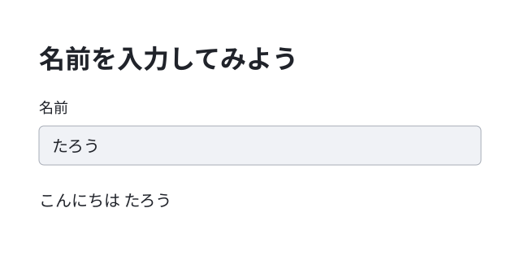

# 基礎編：さっさと学びたい人へ：目次

> **「作れるものを見て選びたい！完成した画面はどこ？」**

最初から完成しているプログラムを選んでください。保存して動かした後、**その完成コードを上から読んで学ぶ**コースです。Pythonの基本文法を先に別コースで学ぶ必要はありません。

## どの完成品から学びたい？

### 関数電卓を作りたい

数字・小数点・四則演算のボタンとsin・cosを使える関数電卓です。sin・cosは、斜めの棒の角度から高さや横の長さの割合を求める計算です。Tkinter（ティーケーインター）という画面を作る道具で作る電卓です。

**数字と計算記号が一つの盤面に並ぶ完成した関数電卓を動かせます。** たとえば電卓画面の「C」「1」「.」「5」「+」「2」「.」「5」「=」の各ボタンを順に押すと、結果の欄に `答え: 4` と表示されます。電卓画面の「C」「0」「cos」の各ボタンを順に押すと、結果の欄に `答え: 1` と表示されます。小数の答えは有効数字を最大12桁まで残して表示します。有効数字は、最初に現れる0以外の数字から数えた桁です。表示を整えても、計算の誤差はなくなりません。

公開サンプルをもとにした画面構成図です。実際の色や文字の形はパソコンによって変わります。

[進む：関数電卓を保存して動かす](./教材/完成品の入口/電卓を動かす.md)

[進む：関数電卓の完成コードを先頭から最後まで読む（全9章）](./教材/完成品の入口/電卓/電卓のコードを読む.md)

[別コースへ移る：電卓を最初から作る](../基礎編_ゆっくり学びたい人へ/教材/Tk01_最初のウィンドウ/最初のウィンドウ.md)

### シューティングゲームを作りたい

宇宙船を矢印キーで動かし、Spaceキーで弾を撃って敵とボスを倒すゲームです。pygame-ce（パイゲーム・シーイー）というゲーム画面を描く道具で作るゲームです。

**タイトル画面から始めて、ゲームオーバーやクリア後にタイトルへ戻るところまで入った完成サンプルを動かせます。** 完成コードを上から読む教材は、起動・画面やフォントの準備・画像の読み込み・自機の開始位置と移動の4章まで公開しています。

公開サンプルをもとにした画面構成図です。SPACE SHOOTERは「宇宙のシューティング」、Defeat the boss!は「ボスを倒そう」、STARTは「開始」という意味です。

[進む：完成ゲームを保存して遊ぶ](./教材/20_完成ゲームを読む/01_完成ゲームを動かす.md)

[進む：完成ゲームのコードを読む目次](./教材/20_完成ゲームを読む/目次.md)

[別コースへ移る：ゲームを最初から作る](../基礎編_ゆっくり学びたい人へ/教材/Pg01_最初のゲーム画面/最初のゲーム画面.md)

### ブラウザで動くアプリを作りたい

**ブラウザの入力欄に名前を入れると、その名前で挨拶するアプリを動かせます。** Streamlit（ストリームリット）というブラウザ画面を作る道具で作るアプリです。

自分のパソコンで起動し、ブラウザで操作してください。名前を変えると、表示する挨拶も変わります。

公開サンプルをもとにした画面構成図です。`たろう` は入力する名前の例です。

[進む：完成したブラウザアプリを保存して動かす](./教材/完成品の入口/ブラウザアプリを動かす.md)

[進む：ブラウザアプリのコードを読む・変更する](./教材/完成品の入口/ブラウザアプリ/ブラウザアプリのコードを読む.md)

## 天気を自動で取得するプログラムを作りたい

> **「天気サイトを見て、気温と湿度を毎回書き写すのは面倒！」**

Requests（リクエスツ）という通信の道具でWeb API（外部のサービスから情報を受け取る窓口）に接続し、気温と湿度を読み取ってターミナルへ表示する完成プログラムです。受け取ったJSON（名前と値を組にしたデータ）から必要な数字を取り出します。

Pythonと追加の道具の準備から、完成したプログラムの実行、コードの読み方、場所や表示の変更まで同じページで試せます。**このプログラムはWebサイトの画面を作るものではありません。** ブラウザで操作するアプリは上のStreamlitルートを選んでください。

[進む：完成した天気取得プログラムを動かして読む](./教材/19_Webから天気を取得する/今の気温と湿度をWebから調べたい.md)

## 動かす前の準備

PythonとVS Codeをまだ使えない場合は、コードを書いて実行するための準備をしてください。準備後は、選んだ完成品のページへ戻ってください。

[進む：Pythonを書いて動かす準備をする](./教材/環境構築/環境構築ガイド.md)

## Webサイトを公開したい場合

Webサイトを作って公開する専用の教材は準備中です。上のブラウザアプリは、自分のパソコンで起動して使うサンプルです。

[進む：応用編の公開状況を見る](../応用編_ゆっくり作りたい人へ/教材/準備中.md)

---

[進む：この系列の公開状況を見る](./教材/準備中.md)

[別コースへ移る：Pythonを順に学ぶ](../基礎編_ゆっくり学びたい人へ/初めに.md)

[戻る：この系列の入口](./初めに.md)

[戻る：Python教材の入口](../初めに.md)
