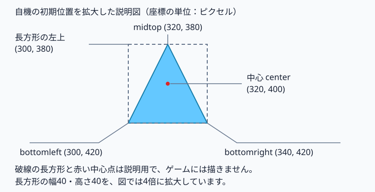
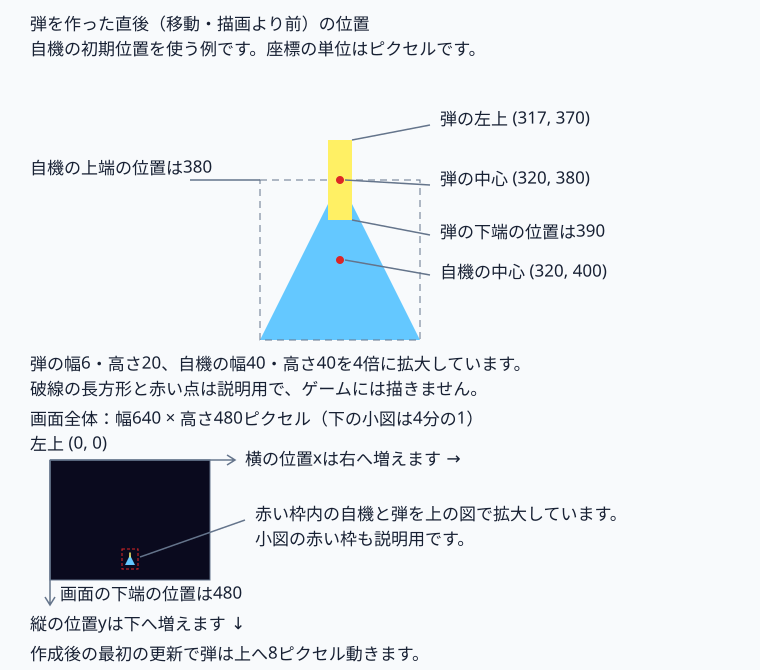
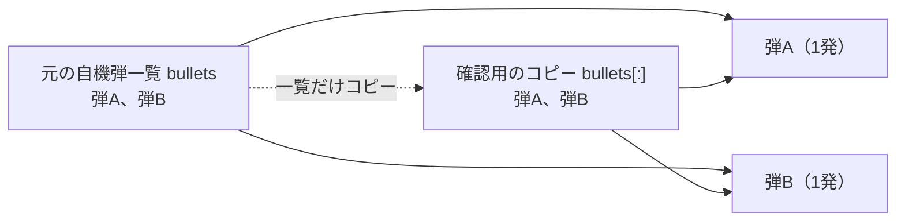
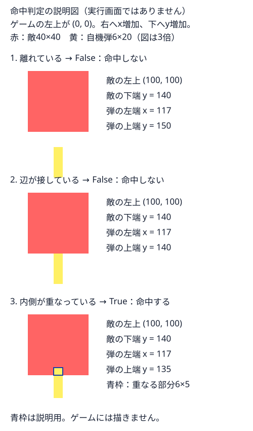

# Pg6. pygame「敵が攻撃してくる」

Pg5では、敵を撃って倒せるようになりました。

でも今の敵は、ただ降りてきて撃たれるだけです。

> **「敵、ただの的じゃん。撃ち返してこいや！」**

今回は、敵からも弾を撃たせます。
敵弾が自機に当たると、自機のHP（体力）が減ります。自機のHPが0以下になるとゲームオーバーです。

---


## Pythonファイルの保存場所

この章のPythonファイルは、練習用フォルダ内の `src` へ保存してください。

この章のコードを保存する練習用フォルダを1つ選んでください。まだない場合は、保存したい場所で、Windowsはエクスプローラーの **新規作成 → フォルダー**、macOSはFinderの **ファイル → 新規フォルダ**、Linux（GNOMEの「ファイル」）は右クリックの **新しいフォルダー** を選び、練習用フォルダを作ってください。

練習用フォルダの中で、Windowsはエクスプローラーの空いている場所を右クリックして **新規作成 → フォルダー**、macOSはFinderの **ファイル → 新規フォルダ**、Linux（GNOMEの「ファイル」）は空いている場所を右クリックして **新しいフォルダー** を選んでください。フォルダ名を `src` と入力してEnterキーを押すと、練習用フォルダの中に `src` ができます。すでに `src` がある場合はそのフォルダを使い、保存済みのコードは必要な変更だけを行ってください。

VS Codeで開くフォルダと、ターミナルの `cd` で移動するフォルダは、`src` の一つ上の練習用フォルダです。保存先を選ぶときは `src` を開き、起動するときは練習用フォルダから `src/main.py` を指定してください。実行手順のコマンドは、この練習用フォルダから入力してください。

専用のPythonを用意する `.venv` は、`src` の一つ上の練習用フォルダに置いてください。

## この章のファイルを保存する

下のリンクを1つずつ開き、GitHubの **Raw** でコードだけを表示してください。全体をコピーし、VS Codeの新しいファイルへ貼り付けて、表と同じ名前で、練習用フォルダ内の `src` へ保存してください。Windows / LinuxはCtrl + A、Ctrl + C、Ctrl + N、Ctrl + V、Ctrl + S、macOSは対応するCommandキーの操作を使ってください。

実行用コードがある章では、起動するファイルを `main.py` に揃えています。Pg15は次の学習先を選ぶ案内ページなので、実行用コードはありません。`main.py` はpygameを使う準備をし、`game.py` の `Game` を起動します。各章で追加するゲームの機能は、`game.py`、`battle.py`、`enemy.py` など役割を持つファイルに書きます。`main.py` は変更せず、補助ファイルはこの章の版で揃えて保存してください。この章だけを保存して動かせます。

| ファイル | 役割 | 前章からの違い |
| --- | --- | --- |
| [main.py](./src/main.py) | `main.py` はpygameを使う準備をし、`game.py` のゲーム全体の処理を開始します | 同じ |
| [battle.py](./src/battle.py) | Battle：1回の戦闘、自機・敵・弾の一覧と更新順 | 変更 |
| [bullet.py](./src/bullet.py) | Bullet：弾の位置・移動・画面外判定・描画 | 同じ |
| [collisions.py](./src/collisions.py) | 弾と機体の当たり判定、弾の削除とダメージ | 変更 |
| [enemy.py](./src/enemy.py) | Enemy：通常の敵の位置・移動・発射・描画 | 変更 |
| [game.py](./src/game.py) | Game：ウィンドウ・画面更新の速さ・ゲームの繰り返し | 変更 |
| [player.py](./src/player.py) | Player：自機の位置・移動・発射・描画 | 変更 |
| [settings.py](./src/settings.py) | ゲームで使う数値（画面の大きさ、自機の初期位置、機体や弾の移動量、自機の体力、敵弾の発射間隔）を設定名と一緒にまとめる | 変更 |


**実行するファイルは `main.py` です。**

## 起動してから1回の更新が終わるまで

`main.py` を実行すると、PythonはPygameを準備して `Game.run()` を始めます。`Game.run()` は、ウィンドウを閉じる操作を確認し、戦闘中の自機・敵・弾の状態を更新して、描いた画面を表示します。画面更新の速さは `self.clock.tick(settings.FPS)` で1秒あたり最大 `settings.FPS` 回に抑えます。

`self` はそのクラスから作ったもの自身です。`self.player` はその戦闘が持つ自機、`self.bullets` はその戦闘が持つ弾の一覧です。`__init__` は作るときの初期値を用意します。`from player import Player` は同じフォルダのplayer.pyから自機の型を読み込む指定です。

`main.py` を直接実行すると、Pythonは `main()` を動かし、`game.py` の `Game` がゲーム画面を開きます。別のPythonファイルから `main.py` を読み込んだだけでは、`main()` は動かず、ウィンドウも開きません。読者がウィンドウの閉じるボタンを押すと、`Game.handle_events()` は `pygame.event.get()` から閉じる操作の知らせ `pygame.QUIT` を受け取り、`self.running` を `False` にします。`Game.run()` はその値を見て画面更新の繰り返しを終え、`main.py` に戻ります。

`main.py` の `try:` 内には、ゲーム画面を作る `Game()` と、操作の確認・画面更新を繰り返す `game.run()` があります。Pythonは `Game()` と `game.run()` が正常に終わった場合も、実行中にエラーが起きた場合も、`finally:` 内の `pygame.quit()` を実行します。`pygame.quit()` は使用中のPygameの機能を片付け、開いていたゲームのウィンドウを閉じます。`Game()` や `game.run()` のエラーは `finally:` では解決されず、片付けの後にPythonがエラーを表示します。

### 起動用の `main.py`

このコードの元ファイル：[`main.py` の 1〜27行](./src/main.py#L1-L27)。

```python
# 起動と終了の順序を画面を更新する処理へ混ぜると、準備や片付けの場所を探しにくくなります。
# main（開始する処理）へPygameの準備・ゲームの実行・終了後の片付けをまとめます。
# Pythonがゲーム画面・キー入力・描画を扱う道具pygameを読み込みます。
import pygame
# Pythonが同じsrcフォルダのgame.pyから、画面と進行をまとめるGame（ゲーム全体）の定義を読み込みます。
from game import Game

# defは名前を付けた処理の定義。main()と書くと、Pythonがmainの字下げした処理を実行します。
def main():
    # pygame.init()がPygameの各機能を使う準備をします。ゲームのウィンドウはGame()で作ります。
    pygame.init()
    # Pythonは、このtry内のGame()とgame.run()が正常に終わった場合も、エラーで中断した場合もfinallyへ進みます。
    try:
        # PythonがGame()でゲーム画面と進行に必要な情報を作り、変数gameから使えるようにします。
        game = Game()
        # game.run()が操作の確認と画面更新を繰り返します。閉じる操作でrunが終わると、Pythonはfinallyへ進みます。
        game.run()
    finally:
        # pygame.quit()が使用中のPygameの機能を片付け、開いていたゲームのウィンドウを閉じます。
        # Game()やgame.run()のエラーはfinallyでは解決されず、片付けの後にPythonがエラーを表示します。
        pygame.quit()

# __name__はPythonが付ける名前。main.pyを直接実行したとき、Pythonは__name__を"__main__"にします。
# ==は等しいか調べる記号。main.pyを読み込んだだけの場合、Pythonは次のmain()を実行しません。
if __name__ == "__main__":
    # Pythonがmain()を実行し、Pygameの準備からゲームの実行・終了後の片付けまでを開始します。
    main()
```

## ゲームのウィンドウと進行を用意する

自機や敵を動かす処理へ、ウィンドウを作る処理や閉じる操作まで詰めると、戦闘の処理とゲーム全体の処理を追いにくくなります。`Game`（ゲーム全体）へ描画先・更新の間隔・ゲームを続けるかの情報と、その情報を使う操作をまとめます。自機・敵・弾は、戦闘を担当する`Battle`へ持たせます。[game.py 8〜30行](./src/game.py#L8-L30)・[battle.py 14〜46行](./src/battle.py#L14-L46)

`main()`が`Game()`を実行すると、Pythonは`Game.__init__`で作成時の準備を行います。毎回の更新でもウィンドウや戦闘を作り直すと、描画先や自機の状態が新しいものに戻ってしまうため、準備は`__init__`、操作の確認と更新の繰り返しは`run`へ分けています。[main.py 9〜22行](./src/main.py#L9-L22)・[game.py 8〜24行](./src/game.py#L8-L24)・[game.py 32〜60行](./src/game.py#L32-L60)

| `Game.__init__`が用意するもの | 役割と後の使い道 |
| --- | --- |
| `self.screen`：絵を描く先 | `pygame.display.set_mode`が幅`settings.WIDTH`・高さ`settings.HEIGHT`のウィンドウを開き、描画先の`Surface`（画像を持つPygameの部品）を返します。初期設定は幅640・高さ480ピクセルです。`Battle.draw`は同じ描画先へ絵を描き、`Game.run`の`pygame.display.flip()`が画面全体を表示します。[game.py 12〜13行](./src/game.py#L12-L13)・[settings.py 1〜6行](./src/settings.py#L1-L6)・[game.py 54〜58行](./src/game.py#L54-L58) |
| ウィンドウの題名 | `pygame.display.set_caption`が「敵が攻撃してくる」をウィンドウの題名にします。HPのようにゲーム画面の中へ描く文字とは別です。[game.py 14〜15行](./src/game.py#L14-L15) |
| `self.clock`：更新間隔を扱う部品 | `pygame.time.Clock()`で用意し、`Game.run`が同じ部品の`tick(settings.FPS)`を更新ごとに実行します。初期値の`FPS = 60`は1秒あたりの更新回数の上限です。Clockを作るだけでは待たず、tickが必要な時間を待ちます。毎秒60回の更新を保証する指定ではありません。[game.py 17〜19行](./src/game.py#L17-L19)・[game.py 59〜60行](./src/game.py#L59-L60)・[settings.py 7〜9行](./src/settings.py#L7-L9) |
| `self.running`：更新を続けるか | 最初は`True`（続ける）です。`Game.run`の`while`はこの値で繰り返しを続けるか確認します。閉じる操作やゲームオーバーでは`False`（続けない）へ変わります。[game.py 20〜21行](./src/game.py#L20-L21)・[game.py 32〜60行](./src/game.py#L32-L60)・[game.py 62〜75行](./src/game.py#L62-L75) |
| `self.battle`：このゲームの戦闘 | `Game.start_game`が`Battle()`で作った戦闘です。`Game.run`は同じ戦闘の更新・体力確認・描画を繰り返します。[game.py 23〜30行](./src/game.py#L23-L30)・[game.py 32〜60行](./src/game.py#L32-L60) |

画面を作る機能と更新間隔を扱う機能の仕様：[pygame-ce公式：ウィンドウと描画先を作る](https://pyga.me/docs/ref/display.html#pygame.display.set_mode)・[pygame-ce公式：ウィンドウの題名](https://pyga.me/docs/ref/display.html#pygame.display.set_caption)・[pygame-ce公式：更新回数を制限する](https://pyga.me/docs/ref/time.html#pygame.time.Clock.tick)。

## 閉じる操作とスペースキーの知らせを振り分ける

「スペースキーは弾を撃つ操作だけど、閉じるボタンは誰が見るの？」という場面では、操作の知らせを確認し、終了と戦闘の操作を分ける必要があります。`Game.handle_events`は閉じる操作を判断し、終了以外の知らせは`Battle.handle_event`へ送ります。`Game.run`の中へ操作ごとの分岐を詰めず、操作確認を別の処理へまとめると、更新・判定・描画の順番を追えます。[game.py 62〜75行](./src/game.py#L62-L75)・[game.py 32〜60行](./src/game.py#L32-L60)・[battle.py 48〜55行](./src/battle.py#L48-L55)

`event`（イベント）は、操作や変化を知らせる情報です。`pygame.event.get()`は待っている知らせを一覧として取り出し、Pygame側の待ち一覧から外します。`Game.handle_events`の`for`は、取り出した一覧から1件ずつ`event`へ選びます。`event.type`はその知らせの種類です。[game.py 62〜75行](./src/game.py#L62-L75)・[pygame-ce公式：知らせを取り出す](https://pyga.me/docs/ref/event.html#pygame.event.get)

| 取り出した知らせ | `Game`と`Battle`が行うこと |
| --- | --- |
| `pygame.QUIT`：ウィンドウを閉じる操作 | `Game.handle_events`が`self.running`を`False`にし、`break`で知らせの確認を終えます。閉じる知らせも、その後に並ぶ知らせも戦闘へ送りません。`Game.run`は戦闘を更新する前に繰り返しを終え、`main`へ戻ります。`main`の`finally`内で`pygame.quit()`がウィンドウを閉じます。[game.py 62〜75行](./src/game.py#L62-L75)・[game.py 32〜42行](./src/game.py#L32-L42)・[main.py 18〜22行](./src/main.py#L18-L22) |
| `pygame.KEYDOWN`で`event.key`が`pygame.K_SPACE`：スペースキーを押した操作 | `Game.handle_events`がその知らせを戦闘へ送ります。`Battle.handle_event`が自機の弾1発を作って自機の弾一覧へ追加します。弾を動かして描く処理は、その後の更新と描画で行います。[game.py 74〜75行](./src/game.py#L74-L75)・[battle.py 48〜55行](./src/battle.py#L48-L55)・[battle.py 57〜75行](./src/battle.py#L57-L75)・[battle.py 120〜141行](./src/battle.py#L120-L141) |
| 終了以外で、スペースキーを押した知らせでもない場合 | `Game.handle_events`は戦闘へ送りますが、`Battle.handle_event`の発射条件に当てはまらないため、この知らせによる弾の追加はありません。矢印キーによる移動は、`Battle.update`が今押しているキーの状態を調べて行います。[game.py 74〜75行](./src/game.py#L74-L75)・[battle.py 48〜60行](./src/battle.py#L48-L60) |

同じ一覧に閉じる操作とスペースキーの知らせがある場合、`for`が読む順番も結果に関わります。閉じる知らせが先なら、その後のスペースキーの知らせは戦闘へ届きません。スペースキーの知らせが先なら弾1発が一覧へ追加されますが、その後に閉じる知らせを確認すると、`Game.run`は戦闘の更新と描画をせずに終えるため、その弾は画面へ表示されません。[game.py 62〜75行](./src/game.py#L62-L75)・[game.py 32〜42行](./src/game.py#L32-L42)・[battle.py 48〜55行](./src/battle.py#L48-L55)

## 戦闘で使う自機・敵・弾を用意する

「敵と自機はいるけど、誰が撃った弾なの？」となると、弾が当たったときにどちらの機体を調べるか分かりません。`Battle`（戦闘）に自機・敵と、それぞれが撃った弾の一覧を持たせます。戦闘の情報と、その情報を更新する操作を同じクラスへまとめると、どの戦闘の機体や弾を扱うか追えます。[battle.py 14〜46行](./src/battle.py#L14-L46)

`Game.start_game` は `Battle()` で戦闘を作ります。Pythonは戦闘を作るときに `Battle.__init__` の準備を行い、後の `Game.run` は作成済みの戦闘の `update()` を繰り返します。毎回の更新で自機を作り直すと、移動した位置や減った体力が初期値へ戻ってしまうため、作成時の準備と毎回の更新を分けています。[game.py 25〜30行](./src/game.py#L25-L30)・[game.py 32〜60行](./src/game.py#L32-L60)・[battle.py 14〜46行](./src/battle.py#L14-L46)

| 戦闘が用意するもの | 最初の状態と後の使い道 |
| --- | --- |
| `self.player`：自機 | `Player()`で自機1機を作ります。戦闘は同じ自機を移動・射撃・体力確認で使います。[battle.py 18〜20行](./src/battle.py#L18-L20)・[player.py 全体](./src/player.py) |
| `self.bullets`：自機の弾一覧 | 発射前なので空です。スペースキーで撃った弾を`Battle.handle_event`が追加します。[battle.py 22〜24行](./src/battle.py#L22-L24)・[battle.py 48〜55行](./src/battle.py#L48-L55) |
| `self.enemies`：敵の一覧 | `Enemy`で作った敵3機を追加します。中心位置は左端・上端から数えたピクセル数で、順に`(160, 80)`・`(320, 40)`・`(480, 100)`です。[battle.py 26〜34行](./src/battle.py#L26-L34)・[enemy.py 14〜20行](./src/enemy.py#L14-L20) |
| `self.enemy_bullets`：敵の弾一覧 | 発射前なので空です。敵が撃った弾を`Battle.update_enemies`が追加します。自機の弾一覧とは分けて持ちます。[battle.py 36〜38行](./src/battle.py#L36-L38)・[battle.py 95〜118行](./src/battle.py#L95-L118) |

## 1回の更新で機体と弾を動かす

準備した自機や弾は、作っただけでは動き続けません。`Battle.update`（更新）へ更新1回分の移動と命中判定をまとめ、`Game.run`が同じ戦闘の更新を繰り返します。移動後の位置で命中を調べるため、機体や弾を動かしてから判定します。[battle.py 57〜75行](./src/battle.py#L57-L75)・[game.py 32〜60行](./src/game.py#L32-L60)

`Battle.update`は、次の順番で処理します。[battle.py 57〜75行](./src/battle.py#L57-L75)

1. `pygame.key.get_pressed()`が今押しているキーの状態を調べ、`Player.move`が矢印キーの状態に従って自機を動かします。
2. `Battle.move_bullets`が自機の弾を動かし、上下の画面外へ出た弾を自機の弾一覧から外します。
3. `Battle.update_enemies`が敵を動かし、画面外へ出た敵を敵一覧から外します。発射のタイミングなら、残った敵が弾を撃ちます。
4. `Battle.move_bullets`が敵弾を動かし、上下の画面外へ出た弾を敵弾一覧から外します。手順3で作った敵弾も、この更新で動きます。
5. `hit_enemies`が自機の弾と敵の重なりを調べ、命中した弾と敵を一覧から外します。
6. `hit_player`が敵弾と自機の重なりを調べ、命中した敵弾を一覧から外し、自機の体力を減らします。

自機の弾と敵弾は、どちらも「各弾を動かし、画面外へ出た弾を一覧から外す」という手順なので、同じ`Battle.move_bullets`を使います。`Battle.update`が自機の弾一覧か敵弾一覧を指定し、`Battle.move_bullets`は指定された一覧だけを変更します。弾の向きや移動量は、各弾が持つ値を`Bullet.move`が使います。[battle.py 83〜93行](./src/battle.py#L83-L93)・[bullet.py 22〜32行](./src/bullet.py#L22-L32)

敵の発射は、自機の弾による命中判定より先です。発射のタイミングに自機の弾が敵へ当たる場合、その敵は撃ってから一覧から外れます。[battle.py 57〜75行](./src/battle.py#L57-L75)・[battle.py 95〜118行](./src/battle.py#L95-L118)

## 自機の中心位置と三角形を対応させる

「中心は320なのに、左端は300？　同じ自機の位置じゃないの？」となるのは、中心と左端で測る場所が違うためです。`Player`（自機）は位置・移動量・体力と、自機を動かす・撃たせる・描く操作を同じクラスへまとめます。`Player`の中の`self`は、操作する自機1機を指します。[player.py 8〜24行](./src/player.py#L8-L24)

`Player.__init__`は`pygame.Rect(0, 0, 40, 40)`へ左端・上端・幅・高さを指定し、自機の位置と大きさを扱う長方形を用意します。最初の左端0・上端0は仮の位置で、続く`self.rect.center`の指定で中心を`(settings.PLAYER_X, settings.PLAYER_Y)`へ移します。`center`は長方形の中心です。自機の幅40・高さ40ピクセルは、この位置変更では変わりません。[player.py 12〜16行](./src/player.py#L12-L16)・[pygame-ce公式：長方形の位置と大きさ](https://pyga.me/docs/ref/rect.html)

画面の位置は左上を`(0, 0)`とし、横の位置は右へ行くほど、縦の位置は下へ行くほど増えます。初期設定の中心は横320・縦400ピクセルです。長方形の幅と高さが40なので、左端は`320 - 20 = 300`、上端は`400 - 20 = 380`になります。[player.py 12〜16行](./src/player.py#L12-L16)・[settings.py 10〜15行](./src/settings.py#L10-L15)



この図はコードの初期値から作った説明図です。実行画面の画像ではありません。破線の長方形と赤い中心点は説明用で、`Player.draw`が描くのは水色の三角形です。[player.py 67〜74行](./src/player.py#L67-L74)

自機の位置を用意するだけでは絵は出ません。`Player.draw`（描く）へ、現在の長方形から3点を選んで三角形を描く処理を分けます。`Battle.draw`は自機を描くときに同じ自機の`draw(screen)`を実行し、描画先を指定します。[player.py 67〜74行](./src/player.py#L67-L74)・[battle.py 120〜141行](./src/battle.py#L120-L141)

| 三角形を結ぶ点 | 自機の長方形から選ぶ場所と初期値 |
| --- | --- |
| `self.rect.midtop` | 上辺の中央。横は中心320、縦は上端380で、`(320, 380)`です。[player.py 69〜71行](./src/player.py#L69-L71) |
| `self.rect.bottomleft` | 左下。横は左端300、縦は下端420で、`(300, 420)`です。[player.py 69〜71行](./src/player.py#L69-L71) |
| `self.rect.bottomright` | 右下。横は右端340、縦は下端420で、`(340, 420)`です。[player.py 69〜71行](./src/player.py#L69-L71) |

`points`は、表の3点を上辺の中央・左下・右下の順で並べた一覧です。`pygame.draw.polygon`（多角形を描く処理）は、描画先・色・点の一覧を指定すると、点を順に結び、最後の点から最初の点へ戻る図形を描きます。この例は3点なので三角形になり、色は赤100・緑200・青255の水色です。各色の強さは0〜255で指定します。太さを省略したこの例では、三角形の内側を塗ります。[player.py 67〜74行](./src/player.py#L67-L74)・[pygame-ce公式：多角形を描く](https://pyga.me/docs/ref/draw.html#pygame.draw.polygon)

自機の見た目は三角形ですが、位置の管理と敵弾の命中判定には`self.rect`の長方形を使います。敵弾の長方形と自機の長方形に面積の重なりがあれば命中です。三角形の色が塗られていない角の部分でも、長方形どうしが重なれば体力が減ります。[collisions.py 32〜45行](./src/collisions.py#L32-L45)・[player.py 67〜74行](./src/player.py#L67-L74)

移動後の`Player.draw`は、初期位置の数値を使い続けるのではなく、更新された`self.rect`から3点を選び直します。位置情報を変える処理と、その位置へ描く処理を分けても、同じ自機の長方形を使うため見た目が移動に対応します。[player.py 26〜50行](./src/player.py#L26-L50)・[player.py 67〜74行](./src/player.py#L67-L74)

## 矢印キーで自機を動かし、画面内に収める

「矢印キーを押し続けているのに、1回動いて止まっちゃう！」となると、自機を動かし続けられません。`Battle.update`は更新ごとに今押しているキーの状態を調べ、`Player.move`（移動）へ指定します。`Player.move`へキーの確認と位置変更をまとめ、弾を作る`Player.shoot`とは分けています。[battle.py 57〜60行](./src/battle.py#L57-L60)・[player.py 26〜50行](./src/player.py#L26-L50)

`keys`は、`Battle.update`が`pygame.key.get_pressed()`で調べたキーの状態です。`keys[pygame.K_LEFT]`は左矢印キーの状態を選び、`True`なら押している、`False`なら押していないことを表します。`pygame.K_RIGHT`は右、`pygame.K_UP`は上、`pygame.K_DOWN`は下の矢印キーを選ぶ名前です。[player.py 28〜44行](./src/player.py#L28-L44)・[pygame-ce公式：今押しているキーを調べる](https://pyga.me/docs/ref/key.html#pygame.key.get_pressed)

`if keys[pygame.K_LEFT]:`は、左矢印キーを押しているときだけ、下に字下げして書いた位置変更を行う指定です。字下げは、行頭の空白を増やして行を右へずらすことです。左キーの状態が`False`なら、左へ動かす行は実行しません。右・上・下も、それぞれの`if`で確認します。[player.py 29〜44行](./src/player.py#L29-L44)

`self.rect.x`は自機の長方形の左端、`self.rect.y`は上端です。`self.speed`は自機が作られたときに持たせた、更新1回で方向ごとに動く量です。初期設定の5ピクセルを使う場合、初期位置の左端300・上端380からの1回の更新は次のようになります。表の各行は、同じ初期位置からその方向だけを押した例です。[player.py 12〜20行](./src/player.py#L12-L20)・[player.py 29〜44行](./src/player.py#L29-L44)・[settings.py 10〜19行](./src/settings.py#L10-L19)

| 押しているキー | 左端・上端の変更と自機の動き |
| --- | --- |
| 左矢印キー | `self.rect.x -= self.speed`は左端から移動量を引き、左端を`300 - 5 = 295`へ変更します。上端380は変わらず、自機全体が左へ動きます。[player.py 29〜32行](./src/player.py#L29-L32) |
| 右矢印キー | `self.rect.x += self.speed`は左端へ移動量を足し、左端を`300 + 5 = 305`へ変更します。上端380は変わらず、自機全体が右へ動きます。[player.py 33〜36行](./src/player.py#L33-L36) |
| 上矢印キー | `Player.move`が自機の上端`self.rect.y`を`380 - 5 = 375`へ変更します。左端300は変わらず、自機全体が上へ動きます。画面の縦の位置は下へ増えるので、上へ動かすときは引きます。[player.py 37〜40行](./src/player.py#L37-L40) |
| 下矢印キー | `Player.move`が自機の上端`self.rect.y`を`380 + 5 = 385`へ変更します。左端300は変わらず、自機全体が下へ動きます。[player.py 41〜44行](./src/player.py#L41-L44) |

`-=`は引いた結果を同じ変数や位置へ入れ直す書き方、`+=`は足した結果を入れ直す書き方です。位置の情報が変わるだけでは画面の絵は動かず、後の`Player.draw`が変更後の長方形から三角形の3点を選び直して描きます。[player.py 29〜44行](./src/player.py#L29-L44)・[player.py 67〜74行](./src/player.py#L67-L74)

`Battle.update`は更新のたびに`Player.move`を実行します。矢印キーを押している間、`Player.move`はその方向の位置変更を繰り返します。矢印キーをどれも押していない更新では、4つの位置変更は行いません。右と上を同時に押すと、初期位置から左端は305・上端は375になり、右上へ斜めに動きます。縦と横をそれぞれ5ピクセル動かすので、斜めの移動距離そのものを5ピクセルに揃える処理ではありません。[battle.py 57〜60行](./src/battle.py#L57-L60)・[player.py 29〜46行](./src/player.py#L29-L46)

4つの`if`は別々の確認なので、左と右を同時に押すと、左端から5を引いてから5を足します。初期位置の左端300は`300 - 5 + 5 = 300`で、横の位置は変わりません。上と下を同時に押す場合も、上端の位置変更は差し引き0です。[player.py 29〜46行](./src/player.py#L29-L46)

### 画面端では長方形が外へ出ないように位置を調整する

「避けていたら自機が画面の外へ行っちゃった！」となるのを防ぐため、`Player.move`はキーによる位置変更の後に`clamp_ip`（長方形を範囲内へ収める操作）を行います。`pygame.Rect(0, 0, settings.WIDTH, settings.HEIGHT)`は画面の左上から幅・高さを持つ長方形です。初期設定では左上`(0, 0)`、幅640・高さ480ピクセルの範囲へ、自機の長方形を収めます。自機の幅40・高さ40は変えません。[player.py 47〜50行](./src/player.py#L47-L50)・[settings.py 1〜6行](./src/settings.py#L1-L6)・[pygame-ce公式：長方形を範囲内へ収める](https://pyga.me/docs/ref/rect.html#pygame.Rect.clamp_ip)

左端が2で、移動量5の自機を左へ動かすと、キーの位置変更では左端が`2 - 5 = -3`になります。`clamp_ip`は自機が左へはみ出した分を戻し、左端を0にします。結果として、その更新で実際に左へ動く距離は2ピクセルです。左端0で左を押し続けても、調整後の左端は0のままです。[player.py 29〜32行](./src/player.py#L29-L32)・[player.py 47〜50行](./src/player.py#L47-L50)

自機の幅と高さが40なので、画面の右端では左端が`640 - 40 = 600`、下端では上端が`480 - 40 = 440`までになります。初期設定で調整後の左端は0〜600、上端は0〜440の範囲です。`clamp_ip`は中央の点だけでなく、自機の長方形全体が画面に収まるよう位置を変えます。[player.py 12〜16行](./src/player.py#L12-L16)・[player.py 47〜50行](./src/player.py#L47-L50)・[settings.py 1〜6行](./src/settings.py#L1-L6)

## 自機の上端から弾を作り、戦闘へ加える

「スペースキーは押したけど、弾はどの位置から出るの？」という場面では、自機の現在の位置から弾の位置を決める必要があります。`Player.shoot`（発射）は自機の位置から弾1発を作ります。自機の位置を知る`Player`へ弾の作成をまとめ、弾一覧を持つ`Battle`へ追加する操作は別にしています。[player.py 52〜60行](./src/player.py#L52-L60)・[battle.py 48〜55行](./src/battle.py#L48-L55)

`Player.shoot`の`Bullet(...)`は、同じ`src`の`bullet.py`で定義した弾1発の部品を作る呼び出しです。`Bullet.__init__`の横の中心`x`・縦の中心`y`・縦の移動量`speed`・幅と高さ`size`・色`color`の順に値を指定します。[player.py 52〜60行](./src/player.py#L52-L60)・[bullet.py 13〜26行](./src/bullet.py#L13-L26)

| `Player.shoot`が指定する値 | 弾に使う場所と初期設定の例 |
| --- | --- |
| `self.rect.centerx` → `x` | `Player.shoot`は自機の横の中心を弾の横の中心へ使います。自機の初期位置なら320ピクセルです。[player.py 53〜59行](./src/player.py#L53-L59)・[settings.py 10〜12行](./src/settings.py#L10-L12) |
| `self.rect.top` → `y` | `Player.shoot`は自機の上端を弾の縦の中心へ使います。自機の初期の中心400、高さ40なら、上端は380ピクセルです。弾の上端へ指定する値ではありません。[player.py 12〜16行](./src/player.py#L12-L16)・[player.py 53〜59行](./src/player.py#L53-L59)・[bullet.py 16〜21行](./src/bullet.py#L16-L21) |
| `-settings.BULLET_SPEED` → `speed` | `Player.shoot`は初期設定8を負にした-8ピクセル/更新を指定します。`Bullet.move`が縦の位置へ-8を足すため、弾は上へ動きます。[settings.py 20〜23行](./src/settings.py#L20-L23)・[player.py 54〜59行](./src/player.py#L54-L59)・[bullet.py 28〜32行](./src/bullet.py#L28-L32) |
| `(6, 20)` → `size` | 弾の幅6・高さ20ピクセルの組です。`Bullet.__init__`は最初の値`size[0]`を幅、2番目の値`size[1]`を高さへ使います。[player.py 55〜60行](./src/player.py#L55-L60)・[bullet.py 17〜19行](./src/bullet.py#L17-L19) |
| `(255, 240, 100)` → `color` | 赤255・緑240・青100の黄色の組です。各色の強さは0〜255で指定します。弾は色を持ち、`Bullet.draw`が描画先へ弾を描くときに使います。[player.py 55〜60行](./src/player.py#L55-L60)・[bullet.py 25〜26行](./src/bullet.py#L25-L26)・[bullet.py 43〜47行](./src/bullet.py#L43-L47) |



図は、自機の初期位置から弾を作った直後で、まだ弾を動かしていない状態です。弾の中心は`(320, 380)`なので、幅6・高さ20から左端は317、上端は370、下端は390になります。自機の上端380へ弾の中心を置くため、弾の下半分は自機の長方形と重なります。自機より完全に上へ離して作るコードではありません。[player.py 52〜60行](./src/player.py#L52-L60)・[bullet.py 16〜21行](./src/bullet.py#L16-L21)

`return`は、作った弾1発を`Player.shoot()`の呼び出し元へ返します。`Battle.handle_event`の`self.bullets.append(self.player.shoot())`は、まず自機の`shoot()`で弾を受け取り、`append`（末尾へ追加）で戦闘の自機弾一覧`self.bullets`へ加えます。以前に撃った弾は一覧に残り、新しく作った弾が末尾に追加されます。[player.py 56〜60行](./src/player.py#L56-L60)・[battle.py 48〜55行](./src/battle.py#L48-L55)

弾を作って一覧へ追加するだけでは、移動や描画は行いません。次に`Battle.update`が自機弾一覧を`Battle.move_bullets`へ指定し、各弾の`move()`を1回実行します。初期位置で作った弾の縦の中心380は、最初の更新で`380 + (-8) = 372`へ変わります。まだ一覧に残る弾は、その後の`Battle.draw`で描かれます。図の作成直後の位置と、最初に描かれる位置は異なります。[battle.py 57〜63行](./src/battle.py#L57-L63)・[battle.py 83〜93行](./src/battle.py#L83-L93)・[bullet.py 28〜32行](./src/bullet.py#L28-L32)・[battle.py 120〜141行](./src/battle.py#L120-L141)

`Game.run`は操作確認を先に行い、その後に戦闘を更新します。スペースキーで弾を作る位置は、その更新で自機を動かすより前の自機の位置です。例えば、スペースキーの知らせを確認した時点で自機が初期位置にあり、次の`Battle.update`で右矢印キーを押している場合、作成した弾の横の中心は320のまま、自機は更新で右へ動いて中心325になります。[game.py 32〜45行](./src/game.py#L32-L45)・[game.py 62〜75行](./src/game.py#L62-L75)・[battle.py 48〜63行](./src/battle.py#L48-L63)・[player.py 33〜36行](./src/player.py#L33-L36)

## 敵の位置と発射を `Enemy` にまとめる

敵が3機いると、どの敵の位置を使って弾を作るか分かる必要があります。位置の数値と発射処理を別々に並べると、動かした敵と弾を撃つ敵の対応を追いにくくなります。`Enemy`（敵）というクラスへ、敵1機の位置・移動量と、その敵を動かす・撃たせる・描く操作をまとめます。クラスは情報と操作をまとめる定義です。`Enemy` の中の `self` は、その操作が対象にする敵1機を指します。

`Battle.__init__` は `Enemy(160, 80)`・`Enemy(320, 40)`・`Enemy(480, 100)` を実行し、中心位置が異なる敵3機を戦闘の敵一覧 `self.enemies` へ追加します。`Battle` の中の `self` は戦闘1つを指し、敵の `self` とは別です。[battle.py 16〜46行](./src/battle.py#L16-L46)

`Enemy` の操作は次の5つへ分けます。メソッドは、クラス内に名前を付けて定義した処理です。

| `Enemy` の処理 | 分ける理由と呼び出す場所 |
| --- | --- |
| `__init__`：作成時の準備 | `Enemy` は、移動のたびに開始位置へ戻さないよう、情報の準備を `__init__`、位置変更を `move` に分けて定義します。Pythonが `Battle.__init__` 内の `Enemy(...)` を実行すると、`Enemy.__init__` が敵1機の情報を用意します。[enemy.py 12〜20行](./src/enemy.py#L12-L20)・[battle.py 16〜46行](./src/battle.py#L16-L46) |
| `move`：縦の移動 | `Enemy` は、作成と毎回の位置変更の実行時点が違うため、更新ごとの位置変更を `move` にまとめます。`Battle.update_enemies` が一覧から選んだ敵の `move()` を実行します。[enemy.py 22〜26行](./src/enemy.py#L22-L26)・[battle.py 95〜118行](./src/battle.py#L95-L118) |
| `is_off_screen`：下側の画面外判定 | `Enemy` は、敵1機の位置の比較へ戦闘の一覧変更まで混ぜないよう、判定を `is_off_screen` にまとめ、一覧からの除外は `Battle.update_enemies` に任せます。`Battle.update_enemies` が選んだ敵の判定結果を受け取り、`True` の場合だけ敵一覧から外します。[enemy.py 28〜32行](./src/enemy.py#L28-L32)・[battle.py 95〜118行](./src/battle.py#L95-L118) |
| `shoot`：弾1発の作成 | `Enemy` は、敵の位置から弾を作る処理へ戦闘の一覧変更まで混ぜないよう、作成を `shoot` にまとめ、追加は `Battle.update_enemies` に任せます。`Battle.update_enemies` が選んだ敵の `shoot()` を実行し、返された弾を敵弾一覧へ追加します。[enemy.py 34〜40行](./src/enemy.py#L34-L40)・[battle.py 95〜118行](./src/battle.py#L95-L118) |
| `draw`：長方形の描画 | `Enemy` は、位置の情報だけでは敵の絵が出ないため、位置変更を `move`、描画を `draw` に分けて定義します。`Battle.draw` が敵一覧に残った敵へ描画先を指定し、`Enemy.draw` がその敵を赤系の長方形で描きます。[enemy.py 42〜46行](./src/enemy.py#L42-L46)・[battle.py 120〜141行](./src/battle.py#L120-L141) |

### `enemy.py` 全体を保存する

1. VS Codeの左側のファイル一覧で、練習用フォルダの `src/enemy.py` を開いてください。敵1機の情報と操作を書くファイルが編集画面に表示されます。
2. `src/enemy.py` の編集画面をクリックし、Windows / LinuxはCtrl + A、macOSはCommand + Aを押してください。敵のコード全体が選ばれます。
3. 以下のコード全体をコピーして、選択した `src/enemy.py` へ貼り付け、Windows / LinuxはCtrl + S、macOSはCommand + Sで保存してください。敵のファイル全体がこの章の版へ置き換わります。起動するときは、この章の「保存先へ移動して `main.py` を実行する」で `src/main.py` を実行してください。

元ファイル：[`enemy.py` 全体](./src/enemy.py)。

```python
# Pythonが、敵の位置を長方形で管理し、描画先へ色を塗るpygameの機能を読み込みます。
import pygame
# Pythonが、同じsrcのsettings.pyから敵の移動量・画面の高さ・敵弾の移動量を読み込みます。
import settings
# Pythonが、同じsrcのbullet.pyから弾1発の情報と操作をまとめたBullet（弾）の定義を読み込みます。
from bullet import Bullet

# Enemy（敵）は、敵ごとに異なる位置と、その敵を動かす・撃たせる・描く操作を対応させるため、敵1機の情報と操作をまとめるクラスです。
# Battle.__init__が敵を作り、Battleの敵一覧self.enemiesへ追加します。
# Battle.update_enemiesが敵を動かして画面外の敵を一覧から外し、発射の更新では残った敵のshootを呼び出します。
class Enemy:
    # Enemyは、毎回の移動で開始位置へ戻さないよう、情報の準備を__init__、位置変更をmoveに分けて定義します。
    # selfは作成する敵1機。PythonがEnemy(x, y)を実行すると、__init__が指定された中心位置でその敵の情報を用意します。
    def __init__(self, x, y):
        # rectはrectangle（長方形）の略。pygame.Rectへ左端・上端・幅・高さを指定し、敵の位置と大きさをself.rectへ保存します。
        self.rect = pygame.Rect(0, 0, 40, 40)
        # center（中心）へ(x, y)を指定し、敵の幅40・高さ40を保って中心を指定位置へ移します。ピクセルは画面の位置や大きさを数える単位です。
        self.rect.center = (x, y)
        # speedは速さの指定。settings.ENEMY_SPEEDは更新1回で敵が下へ進む量で、作成時の値を敵のself.speedへ保存します。
        self.speed = settings.ENEMY_SPEED

    # Enemyは、作成時の準備と作成後の位置変更の実行時点が違うため、更新ごとの位置変更をmove（移動）へまとめます。
    def move(self):
        # self.rect.yは敵の上端。+=は足した結果を同じ場所へ保存する書き方で、上端へ保存済みの移動量self.speedを足します。
        # Enemy.moveは敵の横位置と大きさを変えず、中心と下端も上端と同じ量だけ縦へ移します。
        self.rect.y += self.speed

    # Enemyは、敵1機の位置の比較へ戦闘の一覧変更まで混ぜないよう、判定をis_off_screen、一覧からの除外をBattle.update_enemiesへ分けます。
    def is_off_screen(self):
        # Enemy.is_off_screenは敵の上端self.rect.topがゲーム画面の高さsettings.HEIGHTより大きいかを調べ、結果をBattle.update_enemiesへ返します。
        # 上端が高さと等しい場合はFalse（成り立たない）、大きい場合はTrue（成り立つ）です。敵の位置や一覧は変更しません。
        return self.rect.top > settings.HEIGHT

    # Enemyは、敵の位置から弾を作る処理へ戦闘の一覧変更まで混ぜないよう、作成をshoot（発射）へまとめ、追加はBattle.update_enemiesへ任せます。
    def shoot(self):
        # Enemy.shootは敵の横の中心self.rect.centerxと下端self.rect.bottomを、新しい弾の中心位置としてBulletへ指定します。
        # settings.ENEMY_BULLET_SPEEDは下への移動量（ピクセル/回）、(8, 16)は幅・高さ、(255, 100, 180)は赤・緑・青の強さを指定したピンクです。
        # returnが作成した弾1発をBattle.update_enemiesへ返します。Enemy.shoot自体は一覧への追加・弾の移動・描画を行いません。
        return Bullet(self.rect.centerx, self.rect.bottom,
                      settings.ENEMY_BULLET_SPEED, (8, 16), (255, 100, 180))

    # Enemyは、位置の情報だけでは敵の絵が出ないため、位置変更をmove、描画先へ色を塗る処理をdraw（描画）に分けて定義します。
    def draw(self, screen):
        # screenはBattle.drawが指定した描画先。pygame.draw.rectへ描画先・赤系の色・敵の位置と大きさを持つself.rectを指定します。
        # pygame.draw.rectは太さを指定しない場合、長方形の内側を塗ります。敵の位置変更やウィンドウの表示更新は行いません。
        pygame.draw.rect(screen, (255, 100, 100), self.rect)
```

### 敵の中心と、移動する上端を区別する

`Enemy.__init__` の `pygame.Rect(0, 0, 40, 40)` は、左端0・上端0・幅40・高さ40の長方形の情報を作ります。`self.rect.center = (x, y)` は、敵の中心を指定位置へ移します。中心が `(160, 80)` の敵なら、作成直後の左上は `(140, 60)`、下端は100です。ピクセルは画面の位置や大きさを数える単位で、ゲーム画面では右へ進むと横の値、下へ進むと縦の値が増えます。[enemy.py 12〜20行](./src/enemy.py#L12-L20)・[pygame-ce公式：長方形の位置](https://pyga.me/docs/ref/rect.html) [battle.py 26〜32行](./src/battle.py#L26-L32)

`Enemy.move` は敵の上端 `self.rect.y` へ、作成時に保存した移動量 `self.speed` を足します。配布時の `settings.ENEMY_SPEED = 1` なら、最初の更新で上端60は61、中心80は81、下端100は101になります。`Enemy.move` は設定ファイルを毎回読み直さず、その敵の保存値を使います。[enemy.py 22〜26行](./src/enemy.py#L22-L26)・[enemy.py 12〜20行](./src/enemy.py#L12-L20) [settings.py 24〜26行](./src/settings.py#L24-L26)

`Enemy.is_off_screen` は敵の上端がゲーム画面の高さ480より大きい場合だけ `True` を返します。上端480なら `False`、481なら `True` です。画面が描く縦の範囲は0〜479なので、上端480の敵は画面に見えなくても、この比較ではまだ `False` です。`Battle.update_enemies` が `True` を受け取ると、敵を元の `self.enemies` から外します。`Enemy.is_off_screen` 自体は一覧を変更しません。[enemy.py 28〜32行](./src/enemy.py#L28-L32)・[battle.py 95〜118行](./src/battle.py#L95-L118) [settings.py 4〜6行](./src/settings.py#L4-L6)

### 敵の下端を、新しい弾の中心に指定する

`Enemy.shoot` は、選んだ敵の横の中心 `self.rect.centerx` と下端 `self.rect.bottom` を、新しい弾の中心として `Bullet` へ指定します。`Bullet`（弾）は、自機の弾にも使っている、弾1発の情報と操作をまとめたクラスです。`Enemy.shoot` が弾1発を作って返し、`Battle.update_enemies` が戦闘の敵弾一覧 `self.enemy_bullets` へ加えます。[enemy.py 34〜40行](./src/enemy.py#L34-L40)・[battle.py 95〜118行](./src/battle.py#L95-L118)・[bullet.py 全体](./src/bullet.py)

| `Enemy.shoot` が `Bullet` へ指定する値 | 新しい弾への指定と保存先 |
| --- | --- |
| `self.rect.centerx` | `Enemy.shoot` は敵の横の中心を弾の横の中心へ指定します。`Bullet.__init__` が弾の `self.rect.center` の横位置へ保存します。 |
| `self.rect.bottom` | `Enemy.shoot` は敵の下端を弾の縦の中心へ指定します。`Bullet.__init__` が弾の `self.rect.center` の縦位置へ保存します。弾の上端を敵の下端へ揃える指定ではありません。 |
| `settings.ENEMY_BULLET_SPEED` | `Enemy.shoot` は設定値4を弾の下への移動量として指定します。`Bullet.__init__` が弾の `self.speed` へ保存し、`Bullet.move` が更新1回ごとに縦位置へ4ピクセルを足します。  [settings.py 30〜32行](./src/settings.py#L30-L32) |
| `(8, 16)` | `Enemy.shoot` は弾の幅8・高さ16ピクセルを指定します。`Bullet.__init__` が弾の `self.rect` を幅8・高さ16ピクセルで作ります。 |
| `(255, 100, 180)` | `Enemy.shoot` は赤・緑・青の強さを0〜255で指定したピンクを選びます。`Bullet.__init__` が弾の `self.color` へ赤255・緑100・青180の組を保存し、`Bullet.draw` が赤255・緑100・青180のピンクで描きます。 |

### 発射間隔を数える処理を `Battle.update_enemies` にまとめる

敵1機が弾を作る処理へ、戦闘の全ての敵を選ぶ処理や弾一覧の変更まで入れると、誰が発射時刻と一覧を管理するか追いにくくなります。`Battle` は、戦闘で共通の発射間隔を数え、残った敵を選んで撃たせる処理を `update_enemies` にまとめます。`Enemy.shoot` は、選ばれた敵1機の位置から弾を作って返す処理を担当します。[battle.py 95〜118行](./src/battle.py#L95-L118)・[enemy.py 34〜40行](./src/enemy.py#L34-L40)

`Battle.__init__` は、戦闘で共有する更新回数 `self.fire_timer` を0にします。`Battle.update_enemies` は、敵を動かして画面外の敵を一覧から外した後に、戦闘の `self.fire_timer` へ1を足します。敵ごとのタイマーではありません。[battle.py 16〜46行](./src/battle.py#L16-L46)・[battle.py 95〜118行](./src/battle.py#L95-L118)

1. VS Codeで、練習用フォルダの `src/battle.py` を開いてください。戦闘のコードが編集画面に表示されます。
2. Windows / LinuxはCtrl + F、macOSはCommand + Fで `def update_enemies(self):` を検索してください。戦闘が敵の移動・除外・発射を管理する定義が見つかります。
3. `src/battle.py` の `update_enemies` の説明コメントから、最後の `self.enemy_bullets.append(enemy.shoot())` までを、以下のコードへ置き換えてください。コード内の行頭の空白もコピーしてください。Windows / LinuxはCtrl + S、macOSはCommand + Sで `src/battle.py` を保存してください。保存後、`src/battle.py` の `update_enemies` は、この章の敵の移動・除外・発射を管理する処理へ置き換わります。起動するときは、この章の「保存先へ移動して `main.py` を実行する」で `src/main.py` を実行してください。

元ファイル：[battle.py 95〜118行](./src/battle.py#L95-L118)。

```python
    # Battleは、敵1機の移動・弾の作成へ一覧の変更まで混ぜないよう、敵一覧の更新と一斉発射の間隔をupdate_enemiesへまとめます。
    # Battle.updateがupdate_enemiesを1回呼び、Enemy.move・is_off_screen・shootへ敵1機ずつの操作を任せます。
    def update_enemies(self):
        # self.enemies[:]はBattleの敵一覧だけのコピー。forは元のself.enemiesと同じ敵をenemy（選んだ敵）へ1機ずつ選びます。
        # Battle.update_enemiesが元のself.enemiesから敵を外しても、コピーを読むforは次の敵を飛ばしません。
        for enemy in self.enemies[:]:
            # Enemy.moveが選んだ敵の保存済みの移動量で位置を1回進めます。発射位置を使う前に敵を移動します。
            enemy.move()
            # Enemy.is_off_screenが敵の上端と画面の高さを比較し、Trueの場合だけBattle.update_enemiesが除外を行います。
            if enemy.is_off_screen():
                # removeが選んだ敵を元の敵一覧self.enemiesから外します。除外された敵は、この後の発射対象へ入りません。
                self.enemies.remove(enemy)

        # Battle.update_enemiesが、戦闘で共有する更新回数self.fire_timerへ1を足します。敵が0機でもこの回数は進みます。
        self.fire_timer += 1
        # >=は以上か調べる比較。数えた回数がsettings.ENEMY_FIRE_INTERVALに届くと、残った敵を一斉に発射させます。
        if self.fire_timer >= settings.ENEMY_FIRE_INTERVAL:
            # Battle.update_enemiesが回数を0へ戻し、次の発射タイミングまで再び更新を数えます。残った敵が0機でも0へ戻します。
            self.fire_timer = 0
            # forが元の敵一覧self.enemiesに残った敵だけを、enemyへ1機ずつ選びます。
            for enemy in self.enemies:
                # Enemy.shootが選んだ敵の移動後の位置で作った弾を返し、appendがBattleの敵弾一覧self.enemy_bulletsへ加えます。
                # appendは以前の敵弾を置き換えません。Battle.updateが、この呼び出しの後に敵弾の移動と命中判定を行います。
                self.enemy_bullets.append(enemy.shoot())
```

`Battle.update_enemies` は、数えた回数が `settings.ENEMY_FIRE_INTERVAL = 90` に届くと、戦闘の `self.fire_timer` を0へ戻し、敵一覧に残った各敵へ1発ずつ弾を作らせます。`append` は一覧の末尾へ追加する操作で、以前の敵弾を置き換えません。敵が0機でも回数を数えて0へ戻しますが、弾を作る敵はいないため敵弾は追加しません。[battle.py 95〜118行](./src/battle.py#L95-L118) [settings.py 33〜35行](./src/settings.py#L33-L35)

毎秒60回更新できる場合、90回の間隔は約1.5秒です。毎秒30回なら90回は約3秒になります。`Game.run` の `self.clock.tick(settings.FPS)` は更新回数の上限を60回/秒へ抑える指定で、毎秒60回の更新を保証しません。[game.py 32〜60行](./src/game.py#L32-L60)・[settings.py 7〜9行](./src/settings.py#L7-L9)・[settings.py 33〜35行](./src/settings.py#L33-L35)

### 移動・発射・命中を調べる順序

`Battle.update` は、自機を動かし、自機の弾を移動・画面外除外する `self.move_bullets(self.bullets)` を実行してから、`Battle.update_enemies` を呼び出します。`Battle.update_enemies` が敵を動かして画面外の敵を除外し、発射のタイミングなら残った敵の移動後の位置から弾を作ります。`Battle.update` は、その後に `self.move_bullets(self.enemy_bullets)` で敵弾を移動・画面外除外し、残った自機の弾と敵、残った敵弾と自機の順で命中を調べます。画面外の判定で除外済みの弾は、この後の命中判定へ入りません。[battle.py 57〜75行](./src/battle.py#L57-L75)・[battle.py 95〜118行](./src/battle.py#L95-L118)・[battle.py 83〜93行](./src/battle.py#L83-L93)

配布時の設定で、中心 `(160, 80)` から始めた敵が命中も画面外除外もされずに90回目の更新まで残ったと仮定すると、その敵の中心は `(160, 170)`、下端は190です。`Enemy.shoot` が作った弾の中心は `(160, 190)`、左上は `(156, 182)` です。`Battle.update` が同じ更新で弾を下へ4動かすので、敵弾の中心は `(160, 194)`、左上は `(156, 186)` になります。弾を作った時点と、命中を調べて描く時点の位置は違います。[enemy.py 34〜40行](./src/enemy.py#L34-L40)・[battle.py 57〜75行](./src/battle.py#L57-L75)・[bullet.py 全体](./src/bullet.py) [battle.py 26〜32行](./src/battle.py#L26-L32)・[settings.py 24〜26行](./src/settings.py#L24-L26)・[settings.py 30〜35行](./src/settings.py#L30-L35)

敵の発射は自機の弾による命中判定より先です。同じ更新で自機の弾に当たって一覧から外れる敵でも、発射のタイミングなら先に弾を作る場合があります。`hit_enemies` がその敵を外しても、戦闘の `self.enemy_bullets` に追加済みの敵弾は、その敵と一緒には削除されません。[battle.py 57〜75行](./src/battle.py#L57-L75)・[collisions.py 1〜34行](./src/collisions.py#L1-L34)

`Enemy.draw` は敵の長方形の内側を赤系の色で塗り、`Battle.draw` は一覧に残った敵と敵弾を描きます。`Game.run` の `pygame.display.flip()` が描画済みの画面をウィンドウへ表示します。敵の位置情報の変更、弾一覧への追加、描画、表示は、それぞれ別の処理です。[enemy.py 42〜46行](./src/enemy.py#L42-L46)・[battle.py 120〜141行](./src/battle.py#L120-L141)・[game.py 32〜60行](./src/game.py#L32-L60)・[pygame-ce公式：長方形の描画](https://pyga.me/docs/ref/draw.html#pygame.draw.rect)

## 弾1発の位置と動きを `Bullet` にまとめる

自機の弾も敵の弾も、四角い弾を作って縦に動かします。別々に同じ移動・描画処理を書かずに済むように、`Bullet`（弾）というクラスを使います。`Bullet` が持つのは弾**1発分**の情報です。複数の弾を一覧で持つ仕事は `Battle` が担当します。[bullet.py 6〜15行](./src/bullet.py#L6-L15)・[battle.py 16〜38行](./src/battle.py#L16-L38)

VS Codeで `src/bullet.py` を開き、Windows / LinuxはCtrl + F、macOSはCommand + Fで `class Bullet:` を探してください。以下のコードはそのファイルの抜粋です。元のファイルに同じコードがすでにあるため、別のファイルへ追加する必要はありません。

### 弾を作るときに渡す5つの値

`__init__` は弾1発を作ったときに呼ばれます。`self` は**今作っている弾1発**です。同じ `Bullet` から自機弾と敵弾を作っても、それぞれの `self.rect`（長方形）・`self.speed`（縦の移動量）・`self.color`（色）は別々です。[bullet.py 12〜26行](./src/bullet.py#L12-L26)

| `Bullet` に渡す値 | 日本語の意味 | 自機弾の例 | 敵弾の例 |
| --- | --- | --- | --- |
| `x` | 弾の中心の横位置 | 320 | 160 |
| `y` | 弾の中心の縦位置 | 380 | 190 |
| `speed` | 1回の更新で縦に動く量 | -8（上へ8） | 4（下へ4） |
| `size` | 幅と高さの組 | `(6, 20)` | `(8, 16)` |
| `color` | 赤・緑・青の強さ | `(255, 240, 100)`：黄色 | `(255, 100, 180)`：ピンク |

自機弾の例は、自機の中心が初期位置`(320, 400)`にあるときです。敵弾の例は、初期位置`(160, 80)`にいる敵が倒されず、移動量1で90回動いて中心`(160, 170)`になったときです。敵の下端190が新しい敵弾の中心になります。**自機と敵の例は、それぞれ別の場面**です。[player.py 52〜60行](./src/player.py#L52-L60)・[enemy.py 11〜18行](./src/enemy.py#L11-L18)・[enemy.py 34〜40行](./src/enemy.py#L34-L40)・[settings.py 20〜23行](./src/settings.py#L20-L23)・[settings.py 30〜35行](./src/settings.py#L30-L35)

### 幅と高さを決めてから中心を置く

`size` は2つの数値を1つにまとめた組です。`(6, 20)` なら、`size[0]` は0番目の`6`（幅）、`size[1]` は1番目の`20`（高さ）です。番号は0から始まります。

`pygame.Rect(0, 0, size[0], size[1])` は、**左端0、上端0、幅と高さは指定された値**の長方形をいったん作ります。ここでの`(0, 0)`は仮の位置です。その次の `self.rect.center = (x, y)` が中心を指定した位置へ移すため、画面の左上に弾を固定する処理ではありません。[bullet.py 16〜21行](./src/bullet.py#L16-L21)

元ファイル：[bullet.py 16〜26行](./src/bullet.py#L16-L26)。

```python
        # self.rect は「この弾の長方形」です。弾の位置・幅・高さをまとめて持ちます。
        # size は「大きさ」です。size[0] は0番目の幅、size[1] は1番目の高さ。(6, 20)なら幅6、高さ20です。
        # self.rect に、左上を仮の(0, 0)、幅をsize[0]、高さをsize[1]にした長方形を入れます。
        self.rect = pygame.Rect(0, 0, size[0], size[1])
        # self.rect.center に(x, y)を入れ、弾の大きさを保ったまま中心を指定された位置へ動かします。
        self.rect.center = (x, y)
        # speed は「縦の移動量」です。1回の更新で縦に何ピクセル動くかを表します。
        # self.speed にspeedを入れます。負なら上、正なら下、0なら移動しません。
        self.speed = speed
        # color は「色」です。赤・緑・青の強さを表すcolorを、この弾のself.colorに入れます。
        self.color = color
```

たとえば自機弾で幅6・高さ20、中心`(320, 380)`を指定すると、長方形の左端は`320 - 3 = 317`、上端は`380 - 10 = 370`です。したがって左上は`(317, 370)`、下端は390になります。中心・左上・下端の関係は、前の[自機の弾の図](./images/自機弾の作成位置.svg)でも確認できます。

### `move` で弾を1回分動かす

`move`（動かす）は `self.rect.y`、つまり**この弾の長方形の上端の縦位置**へ `self.speed` を足します。`+=` は「元の値に足して保存する」書き方です。横位置・幅・高さは変わりません。[bullet.py 28〜32行](./src/bullet.py#L28-L32)

元ファイル：[bullet.py 28〜32行](./src/bullet.py#L28-L32)。

```python
    # move は「動かす」という意味です。この弾を1回の更新分だけ上下へ動かします。
    def move(self):
        # self.rect.y は弾の上端の縦位置です。+= は今の値に右側の値を足す書き方です。
        # self.rect.y にself.speedを足します。上端を変えると中心と下端も同じ量だけ動きます。
        self.rect.y += self.speed
```

| 弾 | 作った直後の上端 | 移動量 | 1回 `move` した後の上端 | 中心の変化 |
| --- | ---: | ---: | ---: | --- |
| 自機弾 | 370 | -8 | 362 | 380 → 372 |
| 敵弾 | 182 | +4 | 186 | 190 → 194 |

画面は**下へ行くほど縦位置が大きく**なります。だから負の`-8`を足す自機弾は上へ、正の`4`を足す敵弾は下へ動きます。同じ`move`を使っても、各弾が持つ`self.speed`が違うため、動く方向も違います。`Battle.update` がそれぞれの弾を動かしてから、`Battle.draw` が残った弾を描きます。[battle.py 57〜75行](./src/battle.py#L57-L75)・[battle.py 83〜93行](./src/battle.py#L83-L93)

### `is_off_screen` で上下の画面外を調べる

画面の高さは`settings.HEIGHT = 480`です。`self.rect.top` は弾の上端、`self.rect.bottom` は下端です。次の条件のどちらかが成り立つと`True`（画面外）、どちらも成り立たなければ`False`を返します。[bullet.py 34〜41行](./src/bullet.py#L34-L41)

```text
         画面より上
    弾の下端が0より小さい
    ─────────────────── 画面の上端 y=0
           画面内
             ↓
    ─────────────────── 画面の下端 y=480
    弾の上端が480より大きい
         画面より下
```

元ファイル：[bullet.py 34〜41行](./src/bullet.py#L34-L41)。

```python
    # is_off_screen は「画面外か」という意味です。弾が画面の上または下に出たか調べます。
    # 判定結果だけを返します。弾を一覧から外すのは、結果を受け取る Battle の仕事です。
    def is_off_screen(self):
        # self.rect.bottom は弾の下端、self.rect.top は上端、settings.HEIGHT は画面の高さ（480）です。
        # 弾の下端が0より小さいか、弾の上端が画面の高さ480より大きいかを調べます。
        # or は「どちらか」です。どちらかが成り立てばTrue、両方とも成り立たなければFalseを返します。
        # 下端が0・上端が480と等しいときはFalseです。弾は縦にだけ動くので横は調べません。
        return self.rect.bottom < 0 or self.rect.top > settings.HEIGHT
```

| 弾の上端〜下端 | 判定 | 結果 |
| --- | --- | --- |
| -21 〜 -1 | 下端`-1 < 0`が成り立つ | `True` |
| -20 〜 0 | 下端`0 < 0`は成り立たない | `False` |
| 480 〜 500 | 上端`480 > 480`は成り立たない | `False` |
| 481 〜 501 | 上端`481 > 480`が成り立つ | `True` |

比較に使うのは`<`（より小さい）と`>`（より大きい）です。**ちょうど0や480と等しい場合は、まだ`True`になりません。** `is_off_screen` 自体は弾を消しません。`Battle.move_bullets` が`True`を受け取った弾を、指定された自機弾または敵弾の一覧から外します。横方向を調べないのは、この章の`Bullet.move`が横位置を変更せず、どちらの弾も画面内の横位置から作るためです。[battle.py 83〜93行](./src/battle.py#L83-L93)・[player.py 52〜60行](./src/player.py#L52-L60)・[enemy.py 34〜40行](./src/enemy.py#L34-L40)

### `draw` で色の付いた長方形を描く

`draw`（描く）は、`Battle` から渡された描画先`screen`に、その弾の保存済みの色`self.color`で、長方形`self.rect`を塗ります。`pygame.draw.rect` は弾の位置を変更しません。[bullet.py 43〜47行](./src/bullet.py#L43-L47)

元ファイル：[bullet.py 43〜47行](./src/bullet.py#L43-L47)。

```python
    # draw は「描く」という意味です。この弾の今の位置・大きさ・色で画面へ描きます。
    def draw(self, screen):
        # screen は描く先の画面、self.color はこの弾の色、self.rect はこの弾の長方形です。
        # pygame.draw.rect にscreen・self.color・self.rectを渡し、指定した長方形の内側を塗ります。
        pygame.draw.rect(screen, self.color, self.rect)
```

作った弾を動かす`Bullet.move`、画面外の判定`Bullet.is_off_screen`、長方形を描く`Bullet.draw`は別々です。`Battle`が一覧へ弾を追加・除外し、最後に`Game.run`の`pygame.display.flip()`で描いた内容をウィンドウに表示します。[battle.py 83〜93行](./src/battle.py#L83-L93)・[battle.py 120〜141行](./src/battle.py#L120-L141)・[game.py 32〜60行](./src/game.py#L32-L60)

---

## 命中を調べる一覧と、戦闘で残す一覧を分ける

「弾を消したら、次の弾の命中を調べなくなっちゃった！」となるのを防ぐため、命中を確認する一覧と、命中後に要素を外す一覧を分けます。`collisions.py`（コリジョンズ、衝突を扱うPythonファイル）は、敵への命中を調べる`hit_enemies`と、自機への命中を調べる`hit_player`を定義します。`Battle.update`は機体と弾を動かした後に、この2つの処理を順に実行します。[collisions.py 全体](./src/collisions.py)・[battle.py 57〜75行](./src/battle.py#L57-L75)

`hit_enemies(bullets, enemies)`の`bullets`は戦闘の自機弾一覧`self.bullets`、`enemies`は戦闘の敵一覧`self.enemies`です。`Battle.update`が使う元の一覧を指定するため、`hit_enemies`が要素を外すと、戦闘の一覧も変わります。[collisions.py 1〜5行](./src/collisions.py#L1-L5)・[collisions.py 19〜26行](./src/collisions.py#L19-L26)・[battle.py 71〜72行](./src/battle.py#L71-L72)

### `[:]`は一覧を写す書き方

`bullets[:]`は、自機弾の一覧を最初から最後まで別の一覧へ写す書き方です。角括弧の中に`:`だけを書きます。弾1発の部品を新しく作るのではなく、弾を並べる一覧だけを新しく用意します。[collisions.py 6〜9行](./src/collisions.py#L6-L9)・[Python公式：リストのコピー](https://docs.python.org/ja/3/tutorial/introduction.html#lists)

次の図の弾A・弾Bは、説明用に付けた弾2発の呼び名です。コードへ追加する変数名ではありません。元の一覧と確認用のコピーには、別の弾Aを1発ずつ作るのではなく、同じ弾A・同じ弾Bを並べます。



元の`bullets`から弾Aを外しても、`for bullet in bullets[:]`を始めるときに作った確認用のコピーには弾A・弾Bの並びが残っています。弾Aを外した後に`bullets[:]`をもう一度使って新しいコピーを作ると、その新しい一覧に入るのは残った弾Bだけです。弾Aそのものが、コピーの中で別の弾になったわけではありません。`for bullet in bullets[:]`は確認用のコピーから1発ずつ選び、調べる弾を`bullet`という名前で使います。[collisions.py 6〜9行](./src/collisions.py#L6-L9)

### 弾2発が別々の敵に当たる例

自機弾一覧に弾A・弾B、敵一覧に敵C・敵Dがあり、弾Aは敵Cだけ、弾Bは敵Dだけと重なっている例です。命中判定は次の順に進みます。[collisions.py 5〜30行](./src/collisions.py#L5-L30)

| 確認する段階 | 元の自機弾一覧`bullets` | 元の敵一覧`enemies` | `hit_enemies`が行うこと |
| --- | --- | --- | --- |
| 開始時 | 弾A、弾B | 敵C、敵D | `bullets[:]`で、確認用の弾A・弾Bの並びを用意します。 |
| 弾Aの命中処理後 | 弾B | 敵D | `hit_enemies`が命中した弾Aと敵Cを元の一覧から外します。確認用の弾一覧は弾A・弾Bのままです。 |
| 弾Bの命中処理後 | 空の一覧`[]` | 空の一覧`[]` | 外側の`for`がコピーから次の弾Bを選び、`hit_enemies`が命中した弾Bと敵Dを元の一覧から外します。 |

元の一覧を直接読む`for bullet in bullets`へ変えた場合、弾Aを外すと弾Bが先頭へ詰まります。しかし繰り返しは次の位置へ進むため、この弾2発の例では弾Bを飛ばしてしまいます。確認用のコピーを読むと、元の一覧を変えても、コピーで読む弾の順番は変わりません。[collisions.py 6〜9行](./src/collisions.py#L6-L9)・[Python公式：変更する一覧と反復](https://docs.python.org/ja/3/tutorial/controlflow.html#for-statements)

### 敵の確認を終えても、次の弾は調べる

外側の`for`は自機の弾を1発ずつ選び、内側の`for`は、その弾と敵を1機ずつ比べます。`enemies[:]`は弾を1発選ぶたびに、元の敵一覧から作り直します。弾Aの確認で敵Cを外した後、弾Bの確認には残った敵Dだけが入ります。[collisions.py 8〜19行](./src/collisions.py#L8-L19)

`colliderect`は弾と敵の長方形の重なりを調べ、重なれば`True`を返します。`if`はその場合だけ、`remove`（指定した要素を一覧から外す操作）を行います。弾は元の自機弾一覧`bullets`から、敵は元の敵一覧`enemies`から外します。[collisions.py 14〜26行](./src/collisions.py#L14-L26)

命中後の`break`は、内側の「選んだ弾で敵を探す繰り返し」を終えます。自機弾1発は最初に命中した敵1機へ当たって除外され、同じ弾では別の敵を調べません。自機弾1発が同時に敵2機へ重なっている場合、`break`を外すと、最初の敵への命中で外した弾を、次の敵への命中でも`bullets.remove(bullet)`で外そうとします。既に一覧にない弾を外そうとするため、Pythonは`ValueError`（指定した要素が一覧にないことを知らせるエラー）を出します。外側の弾を選ぶ繰り返しは続くため、弾Aの確認を終えても、次の弾Bは調べます。[collisions.py 27〜30行](./src/collisions.py#L27-L30)・[Python公式：内側の繰り返しを終えるbreak](https://docs.python.org/ja/3/tutorial/controlflow.html#break-and-continue-statements)

`remove`は、画面の絵を直接消す操作ではありません。`Battle.draw`が背景を塗ってから、戦闘の一覧に残った機体と弾を描き直すため、一覧から外れた敵と弾はその更新の描画に入りません。[battle.py 120〜141行](./src/battle.py#L120-L141)・[collisions.py 19〜30行](./src/collisions.py#L19-L30)

`hit_player`も敵弾の確認用コピーを読み、命中した敵弾は元の敵弾一覧から外します。ただし敵弾が自機に当たる処理には`break`がなく、その更新で命中した敵弾の数だけ体力が減ります。命中数と体力の例は、この後の「敵弾の命中・体力変更・終了を分ける」で扱います。[collisions.py 32〜45行](./src/collisions.py#L32-L45)

## 弾が触れたように見えるのに、命中しないのはなぜ？

「弾が敵に触れてるのに、まだ消えない！」という場合は、辺が接しただけなのか、長方形の内側まで重なったのかを分けて見ます。`hit_enemies`は、自機弾の`bullet.rect`と敵の`enemy.rect`を`colliderect`（コライドレクト、長方形の重なりを調べる操作）で比べます。`colliderect`が`True`（重なりがある）を返したときだけ、`if`の中の弾と敵を一覧から外す処理へ進みます。`False`（重なりがない）なら、その組の弾と敵は一覧に残します。[collisions.py 14〜30行](./src/collisions.py#L14-L30)

### 辺が接する場合と、内側が重なる場合

次の図は、敵の長方形を左端100・上端100・幅40・高さ40に置き、自機弾を左端117・幅6・高さ20に置いた説明用の例です。位置の単位はピクセル（画面の位置や大きさを数える単位）です。ゲームの左上を横0・縦0として、横位置は右へ、縦位置は下へ進むほど大きくなります。各図は実際の大きさの3倍で、連続する画面更新や実行画面を示すものではありません。敵の40×40と自機弾の6×20は、この章のコードに合わせています。[enemy.py 14〜18行](./src/enemy.py#L14-L18)・[player.py 54〜59行](./src/player.py#L54-L59)



| 自機弾の上端 | 敵の下端との関係 | `colliderect`の結果と`hit_enemies`の処理 |
| --- | --- | --- |
| 150 | 敵の下端140から10ピクセル離れています。 | `False`。この弾と敵を一覧から外しません。 |
| 140 | 自機弾の上辺と敵の下辺が接します。内側は重なりません。 | `False`。この弾と敵を一覧から外しません。 |
| 135 | 横に6、縦に5ピクセルの幅がある部分で内側が重なります。 | `True`。命中した弾と敵を元の一覧から外します。 |

図の青枠は重なる部分を示す説明用の線です。ゲームへ青枠を描く処理はありません。横方向だけ辺が接している場合も、縦方向だけ辺が接している場合も、`colliderect`は`False`を返します。横と縦の両方に幅がある重なりが必要です。[collisions.py 14〜19行](./src/collisions.py#L14-L19)・[pygame-ce公式：colliderect](https://pyga.me/docs/ref/rect.html#pygame.Rect.colliderect)

### 敵弾が自機に当たる場合も、長方形で比べる

`hit_player`は敵弾の`bullet.rect`と自機の`player.rect`を同じ`colliderect`で比べます。敵弾と自機の辺が接しただけなら、`hit_player`は敵弾を外さず、体力も減らしません。内側が重なった場合は、命中した敵弾を外して自機の体力を1減らします。[collisions.py 38〜45行](./src/collisions.py#L38-L45)

自機の見た目は三角形ですが、`hit_player`が比べるのは三角形を囲む幅40・高さ40の長方形です。三角形の色が塗られていない隅でも、自機の長方形の内側と敵弾の長方形が重なれば命中になります。自機の三角形と長方形の対応は、自機の初期位置の説明図でも確認できます。[player.py 13〜17行](./src/player.py#L13-L17)・[player.py 67〜74行](./src/player.py#L67-L74)・[自機の描画と判定の説明図](./images/自機の初期位置.svg)

---

## 敵弾の命中・体力変更・終了を分ける

「敵弾に当たっても平気だったら、避ける意味がない！」という場面では、命中した敵弾に応じて自機の体力を減らす必要があります。弾の移動へ命中判定・体力変更・ウィンドウを閉じる処理まで詰めると、弾が消える理由とゲームが終わる理由を追いにくくなります。`hit_player` は命中した敵弾を一覧から外し、`Player` は自機の体力を変更し、`Battle` は体力が0以下かを判定し、`Game` はゲーム全体の繰り返しを終える役割を担当します。[collisions.py 32〜45行](./src/collisions.py#L32-L45)・[player.py 61〜65行](./src/player.py#L61-L65)・[battle.py 77〜81行](./src/battle.py#L77-L81)・[game.py 32〜60行](./src/game.py#L32-L60)

`Player` は自機のHP（hit points、体力）を `self.hp` に持ち、自機の体力を減らす操作も同じ `Player` の `take_damage` に置きます。自機の体力と、体力を変える処理を別々に置くと、どの機体の値を変えるか追いにくくなるためです。`Battle` の中の `self` は戦闘、`Player` の中の `self` は自機、`Game` の中の `self` はゲーム全体を指します。[player.py 22〜24行](./src/player.py#L22-L24)・[player.py 61〜65行](./src/player.py#L61-L65)

| 処理 | 分ける理由と担当する対象 |
| --- | --- |
| `hit_player`：敵弾と自機の命中判定 | `hit_player` は、敵弾を動かす処理へ一覧の除外と体力変更まで混ぜないよう、命中後の対応をまとめます。`Battle.update` が戦闘の敵弾一覧 `self.enemy_bullets` と自機 `self.player` を指定して呼び出します。[collisions.py 32〜45行](./src/collisions.py#L32-L45)・[battle.py 57〜75行](./src/battle.py#L57-L75) |
| `Player.take_damage`：自機の体力変更 | `Player` は、位置の比較と体力の数値変更を混ぜないよう、自機のHP変更を `take_damage` にまとめ、位置判定は `hit_player` に任せます。`hit_player` が命中した敵弾1発ごとに、自機の `take_damage()` を実行します。[player.py 61〜65行](./src/player.py#L61-L65)・[collisions.py 32〜45行](./src/collisions.py#L32-L45) |
| `Battle.is_game_over`：体力が0以下かの判定 | `Battle` は、戦闘の体力判定へウィンドウの終了まで混ぜないよう、判定を `is_game_over` にまとめ、終了は `Game.run` に任せます。`Game.run` が戦闘の更新後に、自機のHPが0以下かを確認します。[battle.py 77〜81行](./src/battle.py#L77-L81)・[game.py 32〜60行](./src/game.py#L32-L60) |
| `Game.run`：毎回の進行と終了の判断 | `Game` は、ウィンドウの準備と毎回の進行を混ぜないよう、操作確認・戦闘更新・終了判定・描画と表示を `run` にまとめます。`main.py` の `main` が `game.run()` を実行し、`Game.run` が繰り返しを終えた後に `main` へ戻ります。[game.py 32〜60行](./src/game.py#L32-L60)・[main.py 9〜22行](./src/main.py#L9-L22) |

### 自機に最初の体力を保存する

`Player.__init__` は、自機を作るときの `settings.PLAYER_HP = 3` を、自機の `self.hp` へ保存します。`Player.take_damage` は、保存された自機の体力を命中ごとに減らします。設定ファイルを保存しただけでは、起動済みの自機の体力は初期値へ戻りません。[player.py 22〜24行](./src/player.py#L22-L24)・[player.py 61〜65行](./src/player.py#L61-L65)・[settings.py 27〜29行](./src/settings.py#L27-L29)

元ファイル：[player.py 22〜24行](./src/player.py#L22-L24)。以下は、`Player.__init__` 内で自機の最初の体力を保存する部分の抜粋です。

```python
        # hpはhit points（体力）の略。Playerは自機の体力をself.hpへ持ち、take_damageで命中した敵弾1発ごとに1減らします。
        # Player.__init__がsettings.PLAYER_HPの作成時の値をself.hpへ保存します。同じ更新のBattle.updateが終わった後に、Game.runがBattle.is_game_overで自機のHPが0以下かを確認します。
        self.hp = settings.PLAYER_HP
```

### 敵弾を一覧から外して、自機へダメージを与える

「敵弾が1発当たっただけなのに、体力が毎回減ってしまう！」という動きを避けるため、`hit_player`は当たった敵弾を一覧から外し、`player.take_damage()`（自機の体力を1減らす処理）を実行します。同じ更新で敵弾2発が自機に重なれば、`hit_player`が各敵弾について`player.take_damage()`を実行するため、自機の体力は合計2減ります。`hit_player`は1発目で確認を打ち切りません。[collisions.py 32〜45行](./src/collisions.py#L32-L45)

#### 戦闘から何を受け取るか

`Battle.update`は敵弾を動かした後、`hit_player(self.enemy_bullets, self.player)`を実行します。`Battle.update`は、`hit_player(...)`の丸括弧内の1番目に敵弾の一覧、2番目に自機を指定します。`hit_player`の定義では、1番目を`bullets`、2番目を`player`という名前で使います。[battle.py 68〜75行](./src/battle.py#L68-L75)・[collisions.py 34〜35行](./src/collisions.py#L34-L35)

| `Battle.update`が指定する対象 | `hit_player`の中で使う名前と変更 |
| --- | --- |
| `self.enemy_bullets`：戦闘が持つ敵弾の一覧 | `bullets`。`bullets.remove(bullet)`が命中した敵弾を外すと、戦闘の敵弾一覧からもその弾が外れます。[collisions.py 40〜42行](./src/collisions.py#L40-L42) |
| `self.player`：戦闘が持つ自機 | `player`。`player.take_damage()`は戦闘の自機の体力を1減らします。`hit_player`は別の自機を作って体力を減らす処理ではありません。[collisions.py 43〜45行](./src/collisions.py#L43-L45)・[player.py 61〜65行](./src/player.py#L61-L65) |

`hit_player`の`bullets`は敵弾の一覧です。敵への命中を扱う`hit_enemies`でも`bullets`という名前を使いますが、そちらには自機弾の一覧`self.bullets`を指定します。`Battle.update`が各関数へ指定する一覧によって、各関数内の`bullets`が自機弾と敵弾のどちらを扱うかが決まります。[battle.py 71〜75行](./src/battle.py#L71-L75)

#### 命中した敵弾に何をするか

`hit_player` の `bullets` は `Battle` の元の敵弾一覧 `self.enemy_bullets`、`player` は戦闘の自機 `self.player` と同じものを指します。`hit_player` は、自機と敵弾の長方形が面積を持って重なる場合だけ、敵弾を元の一覧から外して自機へダメージを与えます。辺だけの接触なら命中にしません。[battle.py 57〜75行](./src/battle.py#L57-L75)・[collisions.py 32〜45行](./src/collisions.py#L32-L45)・[pygame-ce公式：長方形の重なり](https://pyga.me/docs/ref/rect.html#pygame.Rect.colliderect)

1. VS Codeの左側のファイル一覧で、練習用フォルダの `src/collisions.py` を開いてください。`hit_player` の処理を書くファイルが編集画面に表示されます。
2. Windows / LinuxはCtrl + F、macOSはCommand + Fで `def hit_player(` を検索してください。`src/collisions.py` の `hit_player` の定義が見つかります。
3. [collisions.py 32〜45行](./src/collisions.py#L32-L45)の説明コメントから定義の最後までを、以下のコードへ置き換えてください。行頭の空白もコピーし、Windows / LinuxはCtrl + S、macOSはCommand + Sで `src/collisions.py` を保存してください。保存後、`src/collisions.py` の `hit_player` がこの章のコメント付きの処理へ置き換わります。起動するときは、この章の「保存先へ移動して `main.py` を実行する」で `src/main.py` を実行してください。

元ファイル：[collisions.py 32〜45行](./src/collisions.py#L32-L45)。

```python
# hit_player（自機への命中）は「同じ敵弾で何度も体力が減った！」を防ぐため、命中した敵弾を外し、自機の体力を減らします。
# 敵弾の移動と命中後の対応を分けるため、Battle.updateがhit_playerを実行します。hit_playerは命中した敵弾1発ごとにplayer.take_damage()（自機の体力を1減らす処理）を実行します。
def hit_player(bullets, player):
    # bulletsはBattleの敵弾一覧self.enemy_bullets、playerはBattleの自機self.playerです。hit_playerは新しい弾や自機を作りません。
    # bullets[:]はfor開始時の敵弾一覧のコピーです。hit_playerは弾を作り直しません。hit_playerが元の一覧から弾を外しても、forはコピーから次の弾を選べます。
    for bullet in bullets[:]:
        # rectは位置と大きさを持つ長方形です。colliderectは選んだ敵弾bullet.rectと自機player.rectの内側が重なるかを調べます。
        # colliderectは重なればTrue、辺だけの接触や離れた場合はFalseを返します。ifはTrueのときだけ、下の除外と体力変更を行います。
        if bullet.rect.colliderect(player.rect):
            # removeは指定した弾を一覧から外す操作です。hit_playerは元の敵弾一覧bulletsから、命中した弾bulletを外します。
            bullets.remove(bullet)
            # player.take_damage()は自機の体力を1減らします。外した敵弾は元の一覧に残らず、次の更新の命中判定に入りません。
            # hit_playerはbreak（繰り返しの打ち切り）を使いません。hit_playerは自機の体力が0以下でもコピーに残る敵弾を調べ、命中ごとにplayer.take_damage()を実行します。
            player.take_damage()
```

`hit_player` が元の敵弾一覧 `bullets` から弾を外しながら、同じ元の一覧を順に読んでしまうと、次の弾を飛ばす場合があります。たとえば元の一覧が弾A・弾Bの順で、弾Aを外すと弾Bは最初の位置へ詰まります。`hit_player` は `bullets[:]` で一覧だけをコピーして読むので、元の一覧から弾Aを外した後も、コピーに残る弾Bを次に調べられます。`bullets[:]` は弾自体を作り直さず、コピーと元の一覧は同じ弾を指します。[collisions.py 32〜45行](./src/collisions.py#L32-L45)

命中した弾Aを元の敵弾一覧から外した後は、`Battle` は弾Aを次の更新で動かしたり命中判定したりしません。`Battle.draw` も敵弾一覧に残った弾だけを描きます。元の敵弾一覧からの除外は、描画済みの絵を直接消す操作ではありません。[collisions.py 32〜45行](./src/collisions.py#L32-L45)・[battle.py 57〜75行](./src/battle.py#L57-L75)・[battle.py 120〜141行](./src/battle.py#L120-L141)

### 命中1発につき、自機のHPを1減らす

`Player.take_damage` は自機の体力 `self.hp` から1を引きます。`-=` は、引いた結果を同じ場所へ保存する書き方です。`Player.take_damage` はHPを0で止める処理も、終了判定も行いません。[player.py 61〜65行](./src/player.py#L61-L65)

1. VS Codeの左側のファイル一覧で、練習用フォルダの `src/player.py` を開いてください。`take_damage` の処理を書くファイルが編集画面に表示されます。
2. Windows / LinuxはCtrl + F、macOSはCommand + Fで `def take_damage(` を検索してください。`src/player.py` の `take_damage` の定義が見つかります。
3. [player.py 61〜65行](./src/player.py#L61-L65)の説明コメントから定義の最後までを、以下のコードへ置き換えてください。行頭の空白もコピーし、Windows / LinuxはCtrl + S、macOSはCommand + Sで `src/player.py` を保存してください。保存後、`src/player.py` の `take_damage` がこの章のコメント付きの処理へ置き換わります。起動するときは、この章の「保存先へ移動して `main.py` を実行する」で `src/main.py` を実行してください。

元ファイル：[player.py 61〜65行](./src/player.py#L61-L65)。

```python
    # Playerは、命中の位置判定と自機の体力変更を混ぜないよう、自機のHP変更をtake_damage（ダメージを受ける）へまとめ、位置判定はhit_playerへ任せます。
    def take_damage(self):
        # -=は引いた結果を同じ場所へ保存する書き方。Player.take_damageが自機のself.hpから1を引きます。HPを0で止める処理はありません。
        # Player.take_damageは画面の表示やゲームの終了を行いません。Battle.is_game_overが更新後の自機のHPが0以下かを調べて結果を返し、Game.runが終了を決めます。
        self.hp -= 1
```

`hit_player` は、コピーした敵弾一覧の全ての弾を調べます。命中した後も繰り返しを打ち切らず、自機が0以下のHPになっても、同じ更新の残りの敵弾について命中を調べます。そのため、同じ更新で自機に重なる別の敵弾が複数あれば、自機のHPを複数回減らします。[collisions.py 32〜45行](./src/collisions.py#L32-L45)・[player.py 61〜65行](./src/player.py#L61-L65)

次の表は、配布時の初期HP3から始め、同じ更新で命中する敵弾の数を仮定した説明用の例です。各行は独立した仮定で、順に操作する手順ではありません。画面外除外後の敵弾一覧に、各行の数だけ自機と重なる敵弾が残っていると仮定します。[player.py 22〜24行](./src/player.py#L22-L24)・[settings.py 27〜29行](./src/settings.py#L27-L29)・[battle.py 57〜75行](./src/battle.py#L57-L75)・[collisions.py 32〜45行](./src/collisions.py#L32-L45)

| 仮定する命中数 | `hit_player` と `Player.take_damage` が終わった後の自機のHP |
| --- | --- |
| 0発 | `hit_player` は自機の `take_damage()` を実行せず、HPは3のままです。 |
| 1発 | `Player.take_damage` が自機のHPを3から2へ1回減らします。 |
| 3発 | `Player.take_damage` が自機のHPを3→2→1→0の順に減らします。 |
| 4発 | `Player.take_damage` が自機のHPを3→2→1→0→-1の順に減らします。HPを0へ収める処理はありません。 |

### 自機のHPが0以下かを、戦闘の更新後に確認する

`Battle.is_game_over` は戦闘の自機 `self.player` のHPを `<= 0` で比較します。`<=` は以下か調べる書き方です。自機のHPが2なら `False`、0なら `True`、-1でも `True` を `Game.run` へ返します。`Battle.is_game_over` 自体は、HP変更やゲーム終了を行いません。[battle.py 77〜81行](./src/battle.py#L77-L81)・[game.py 32〜60行](./src/game.py#L32-L60)

1. VS Codeの左側のファイル一覧で、練習用フォルダの `src/battle.py` を開いてください。`is_game_over` の処理を書くファイルが編集画面に表示されます。
2. Windows / LinuxはCtrl + F、macOSはCommand + Fで `def is_game_over(` を検索してください。`src/battle.py` の `is_game_over` の定義が見つかります。
3. [battle.py 77〜81行](./src/battle.py#L77-L81)の説明コメントから定義の最後までを、以下のコードへ置き換えてください。行頭の空白もコピーし、Windows / LinuxはCtrl + S、macOSはCommand + Sで `src/battle.py` を保存してください。保存後、`src/battle.py` の `is_game_over` がこの章のコメント付きの処理へ置き換わります。起動するときは、この章の「保存先へ移動して `main.py` を実行する」で `src/main.py` を実行してください。

元ファイル：[battle.py 77〜81行](./src/battle.py#L77-L81)。

```python
    # Battleは、戦闘の体力判定へウィンドウの終了まで混ぜないよう、HPが0以下かをis_game_over（ゲームオーバーか）へまとめ、終了はGame.runへ任せます。
    def is_game_over(self):
        # Battle.is_game_overが自機self.playerの体力hpを調べ、0以下ならTrue（成り立つ）、正ならFalse（成り立たない）をGame.runへ返します。
        # <=は以下か調べる比較。Battle.is_game_over自体は体力変更・ターミナル表示・繰り返しの終了を行いません。
        return self.player.hp <= 0
```

### 終了を決めた更新も、描画と表示を終える

`Game.run` は `Battle.update` が全ての命中処理を終えた後に、戦闘の `is_game_over()` を実行します。`Game.run` は判定結果が `True` なら実行用ターミナルへ `GAME OVER` を表示し、ゲーム全体の `self.running` を `False` にします。ゲームのウィンドウへ `GAME OVER` と描く処理ではありません。[game.py 32〜60行](./src/game.py#L32-L60)・[battle.py 57〜75行](./src/battle.py#L57-L75)

1. VS Codeの左側のファイル一覧で、練習用フォルダの `src/game.py` を開いてください。`run` の処理を書くファイルが編集画面に表示されます。
2. Windows / LinuxはCtrl + F、macOSはCommand + Fで `def run(` を検索してください。`src/game.py` の `run` の定義が見つかります。
3. [game.py 32〜60行](./src/game.py#L32-L60)の説明コメントから定義の最後までを、以下のコードへ置き換えてください。行頭の空白もコピーし、Windows / LinuxはCtrl + S、macOSはCommand + Sで `src/game.py` を保存してください。保存後、`src/game.py` の `run` がこの章のコメント付きの処理へ置き換わります。起動するときは、この章の「保存先へ移動して `main.py` を実行する」で `src/main.py` を実行してください。

元ファイル：[game.py 32〜60行](./src/game.py#L32-L60)。

```python
    # Gameは、ウィンドウの準備と毎回の進行を混ぜないよう、操作の確認・戦闘の更新・終了判定・描画と表示をrun（実行）へまとめます。
    # main.pyのmainがgame.run()を呼び出します。runが終わるとmainへ戻り、mainのfinally内のpygame.quit()がウィンドウを閉じます。
    def run(self):
        # whileは条件がTrueの間繰り返す指定。Game.runはゲーム全体のself.runningがTrueの間、操作の確認と更新を続けます。
        while self.running:
            # Game.handle_eventsが操作の知らせを確認し、ウィンドウを閉じる知らせならGameのself.runningをFalseへ変更します。
            self.handle_events()
            # Game.runは閉じる操作でself.runningがFalseになった場合、戦闘の更新を行う前にbreakを実行します。
            if not self.running:
                # breakが画面更新のwhileをすぐに終えます。この経路では下の戦闘更新・描画・表示を行いません。
                break

            # Battle.updateが自機・弾・敵を動かし、命中した敵弾を除外して自機の体力を減らします。更新全体が終わってからGame.runへ戻ります。
            self.battle.update()

            # Game.runがBattle.is_game_overで更新後の自機のHPを確認し、0以下でTrueが返った場合だけ終了を決めます。
            if self.battle.is_game_over():
                # Game.runがGAME OVERという文字列を実行用ターミナルへ1行表示します。ゲームのウィンドウへ表示する処理ではありません。
                print("GAME OVER")
                # Game.runがself.runningをFalseにし、次のwhileの確認では繰り返しを続けないようにします。ここにはbreakがなく、今回の描画・表示は続きます。
                self.running = False

            # Battle.drawが更新後の戦闘をGameの描画先self.screenへ描きます。体力表示にも今回の命中後のHPを使います。
            self.battle.draw(self.screen)

            # pygame.display.flipが描画済みの画面をウィンドウへ表示します。HPで終了を決めた場合もこの呼び出しを行います。
            pygame.display.flip()
            # Gameのself.clock.tickがsettings.FPSを更新回数の上限として待ちます。HPで終了を決めた場合もこの呼び出しの後にwhileの条件へ戻ります。
            self.clock.tick(settings.FPS)
```

`Game.run` は、HPで終了を決めた箇所では `break` を実行しません。ゲーム全体の `self.running` を `False` にした後も、`Battle.draw` に更新後の戦闘を描かせ、`pygame.display.flip()` で描画済みの画面を表示し、`self.clock.tick(settings.FPS)` を実行します。`Battle.draw` は、体力の文字にも更新後の自機の `self.player.hp` を使うため、HPが-1なら `HP: -1` を描く処理へ指定します。[game.py 32〜60行](./src/game.py#L32-L60)・[battle.py 120〜141行](./src/battle.py#L120-L141)

`Game.run` は、次の `while self.running` の確認で `False` を見つけ、繰り返しを終えて `main.py` の `main` へ戻ります。`main` の `finally` 内の `pygame.quit()` が使用中のPygameの機能を片付け、ウィンドウを閉じます。終了時の画面を読み取るために、キー入力などを待つ処理はありません。[game.py 32〜60行](./src/game.py#L32-L60)・[main.py 9〜22行](./src/main.py#L9-L22)

ウィンドウを閉じる操作の経路は、HPで終える経路とは違います。`Game.handle_events` が閉じる知らせで `self.running` を `False` にすると、`Game.run` は戦闘更新より前の `break` で繰り返しを終えます。この経路では、その更新の戦闘更新・描画・表示を行いません。[game.py 32〜60行](./src/game.py#L32-L60)・[game.py 62〜75行](./src/game.py#L62-L75)

## 戦闘の絵とHP文字を描いて、ウィンドウへ表示する

「あと何発当たったら終わるのか、画面を見ても分からない！」という場面では、残りの体力を画面へ描く必要があります。`Battle.draw` は、位置やHPを変更する `Battle.update` から描画を分け、更新後の機体・弾・HPを一つの描画先へまとめて描きます。`Game.run` は、その描画が終わった後に `pygame.display.flip()` でウィンドウへ表示します。[battle.py 120〜141行](./src/battle.py#L120-L141)・[battle.py 57〜75行](./src/battle.py#L57-L75)・[game.py 32〜60行](./src/game.py#L32-L60)

`Battle.draw` には、自機の弾一覧と敵弾一覧を順に描く同じ処理が必要です。`Battle.draw_bullets` は一覧を順に読む役割をまとめ、弾1発を描く役割は `Bullet.draw` へ任せます。`Battle.draw_text` は、HP文字列を用意する `Battle.draw` が長くならないよう、文字画像の作成と配置をまとめます。[battle.py 120〜141行](./src/battle.py#L120-L141)・[battle.py 143〜149行](./src/battle.py#L143-L149)・[battle.py 151〜159行](./src/battle.py#L151-L159)・[bullet.py 43〜47行](./src/bullet.py#L43-L47)

### 文字の形と大きさを、戦闘を作るときに用意する

`Battle.__init__` は、文字の形と大きさを決めるフォントを `self.font` へ保存します。`Battle.draw_text` は、保存されたフォントを毎回のHP文字画像に使うので、更新のたびにフォントを作り直しません。[battle.py 39〜42行](./src/battle.py#L39-L42)・[battle.py 151〜159行](./src/battle.py#L151-L159)

`pygame.font.Font(None, 36)` の `None` は、pygame-ce同梱のFreeSans Bold（freesansbold.ttf）を選ぶ指定です。`36` はピクセル（画面上の点を数える単位）で表すサイズ指定です。サイズ指定36から、HP文字画像の実寸の高さが必ず36になるとは判断できません。使用する文字やフォントによって、文字画像の大きさは変わります。標準フォントで日本語が表示できることは前提にしません。[battle.py 39〜42行](./src/battle.py#L39-L42)・[pygame-ce公式：フォントの作成](https://pyga.me/docs/ref/font.html#pygame.font.Font)・[pygame-ce公式：文字画像の作成](https://pyga.me/docs/ref/font.html#pygame.font.Font.render)

元ファイル：[battle.py 39〜42行](./src/battle.py#L39-L42)。

```python
        # BattleはHP（hit points、体力）の文字画像を毎回作るため、文字の形と大きさを決めるフォントを戦闘のself.fontへ保存します。
        # FontのNoneは同梱のFreeSans Boldを選ぶ指定、36はピクセル単位のサイズ指定です。ピクセルは画面上の点を数える単位です。
        # Battle.__init__がフォントを一度作り、Battle.draw_textが保存済みのself.fontで更新後のHPを文字画像にします。36は文字画像の実寸の高さを保証する値ではありません。
        self.font = pygame.font.Font(None, 36)
```

### 背景からHPまで、同じ描画先へ順に描く

`Game.run` は、ゲームの描画先 `self.screen` を `Battle.draw` の `screen` へ指定します。`Battle.draw` は、画面全体を暗い青系の色 `(10, 10, 30)` で塗った後、自機、自機の弾、残った敵、敵弾、HP文字の順に描きます。色の3値は赤・緑・青で、各値は0が暗く255が明るい指定です。背景を最後に塗ると、先に描いた機体や文字を覆ってしまいます。[battle.py 120〜141行](./src/battle.py#L120-L141)・[game.py 32〜60行](./src/game.py#L32-L60)・[pygame-ce公式：画面の色を塗る](https://pyga.me/docs/ref/surface.html#pygame.Surface.fill)

`screen.fill` は前の更新の絵を覆いますが、自機・敵・弾の位置や一覧は変更しません。機体や弾の `draw` は保存済みの位置で描き、命中や画面外判定で一覧から除外された敵・弾は描画の対象に入りません。`Battle.draw` は機体・弾を動かしたり、体力を減らしたりしません。[battle.py 120〜141行](./src/battle.py#L120-L141)・[battle.py 143〜149行](./src/battle.py#L143-L149)・[battle.py 57〜75行](./src/battle.py#L57-L75)・[player.py 67〜74行](./src/player.py#L67-L74)・[enemy.py 42〜46行](./src/enemy.py#L42-L46)・[bullet.py 43〜47行](./src/bullet.py#L43-L47)

1. VS Codeの左側のファイル一覧で、練習用フォルダの `src/battle.py` を開いてください。戦闘の処理を書くファイルが編集画面に表示されます。
2. Windows / LinuxはCtrl + F、macOSはCommand + Fで `def draw(` を検索してください。`Battle.draw` の定義が見つかります。
3. [battle.py 120〜141行](./src/battle.py#L120-L141)の説明コメントから定義の最後までを、以下のコードへ置き換えてください。行頭の空白もコピーし、Windows / LinuxはCtrl + S、macOSはCommand + Sで `src/battle.py` を保存してください。保存後、`Battle.draw` が以下のコメント付きの処理になります。起動時は、この章の「保存先へ移動して `main.py` を実行する」の手順で `src/main.py` を実行してください。

元ファイル：[battle.py 120〜141行](./src/battle.py#L120-L141)。

```python
    # Battleは、位置や体力を変更するupdateと絵を描く処理を混ぜないよう、戦闘全体の描画をdraw（描く）へまとめます。
    # Game.runがゲームの描画先self.screenをscreenへ指定します。Battle.drawは同じ描画先へ背景・機体・弾・HPの順に描きます。
    def draw(self, screen):
        # fillが描画先screen全体を暗い青系の色で塗り、前の更新の絵を覆います。色は赤10・緑10・青30で、各値は0（暗い）から255（明るい）です。
        # Battleの自機・弾・敵の情報は変えず、描画先の色だけを変えます。背景を後から塗ると、その前に描いた機体や文字も覆ってしまいます。
        screen.fill((10, 10, 30))

        # Player.drawが戦闘の自機self.playerの長方形から3点を選び、水色(100, 200, 255)の三角形をscreenへ描きます。Battle.drawは自機を動かしません。
        self.player.draw(screen)
        # Battle.draw_bulletsが戦闘の自機の弾一覧self.bulletsに残る弾をscreenへ描きます。命中や画面外判定で除外した弾は描きません。
        self.draw_bullets(screen, self.bullets)

        # forが戦闘の敵一覧self.enemiesに残る敵をenemy（選んだ敵）へ1機ずつ選びます。空の一覧なら敵を描く処理は0回です。
        for enemy in self.enemies:
            # Enemy.drawが選んだ敵enemyの長方形を赤系の色(255, 100, 100)で同じ描画先screenへ描きます。
            enemy.draw(screen)

        # Battle.draw_bulletsが戦闘の敵弾一覧self.enemy_bulletsに残る弾を同じscreenへ描きます。
        self.draw_bullets(screen, self.enemy_bullets)
        # f付きの文字列は{}内の値を文字列へ組み込みます。自機self.player.hpが3ならHP: 3、2ならHP: 2、-1ならHP: -1をdraw_textへ指定します。
        # Battle.draw_textが白いHP文字画像の左上を、screenの左端から10・上端から10ピクセルへ置きます。Game.runが後のflipで描画済みの画面を表示します。
        self.draw_text(screen, f"HP: {self.player.hp}", (10, 10))
```

### 自機の弾一覧と敵弾一覧に、同じ描画処理を使う

`Battle.draw` は `self.bullets`（自機の弾一覧）と `self.enemy_bullets`（敵弾一覧）を、それぞれ `Battle.draw_bullets` の `bullets` へ指定します。`Battle.draw_bullets` は指定された元の一覧を順に読み、各弾の `Bullet.draw(screen)` を実行します。弾一覧が空なら、弾を描く呼び出しは0回です。[battle.py 120〜141行](./src/battle.py#L120-L141)・[battle.py 143〜149行](./src/battle.py#L143-L149)

1. VS Codeの左側のファイル一覧で、練習用フォルダの `src/battle.py` を開いてください。戦闘の処理を書くファイルが編集画面に表示されます。
2. Windows / LinuxはCtrl + F、macOSはCommand + Fで `def draw_bullets(` を検索してください。`Battle.draw_bullets` の定義が見つかります。
3. [battle.py 143〜149行](./src/battle.py#L143-L149)の説明コメントから定義の最後までを、以下のコードへ置き換えてください。行頭の空白もコピーし、Windows / LinuxはCtrl + S、macOSはCommand + Sで `src/battle.py` を保存してください。保存後、`Battle.draw_bullets` が以下のコメント付きの処理になります。起動時は、この章の「保存先へ移動して `main.py` を実行する」の手順で `src/main.py` を実行してください。

元ファイル：[battle.py 143〜149行](./src/battle.py#L143-L149)。

```python
    # 自機の弾一覧と敵弾一覧を描く繰り返しが同じなので、Battleは一覧の描画をdraw_bulletsへまとめ、弾1発の描画はBullet.drawへ任せます。
    def draw_bullets(self, screen, bullets):
        # Battle.drawが指定したscreenはGameの描画先、bulletsは戦闘のself.bullets（自機の弾）またはself.enemy_bullets（敵弾）と同じ一覧です。
        # forが指定された一覧に残る弾をbullet（選んだ弾）へ1発ずつ選びます。空の一覧ならBullet.drawの呼び出しは0回です。
        for bullet in bullets:
            # Bullet.drawが選んだ弾の保存済みの位置・大きさ・色でscreenへ描きます。Battle.draw_bulletsは弾を動かしたり一覧へ追加・除外したりしません。
            bullet.draw(screen)
```

### HPの数値を文字列へ組み込み、文字画像を置く

`Battle.draw` の `f"HP: {self.player.hp}"` は、`{}` 内の自機のHPを文字列へ組み込みます。HPが3なら `"HP: 3"`、2なら `"HP: 2"`、-1なら `"HP: -1"` になります。`Battle.draw` はこの文字列を `Battle.draw_text` の `text` へ、描画先を `screen` へ、文字画像の左上の位置 `(10, 10)` を `position` へ指定します。[battle.py 120〜141行](./src/battle.py#L120-L141)・[battle.py 151〜159行](./src/battle.py#L151-L159)

| `Battle.draw_text` が使う指定 | 何に使い、どんな結果になるか |
| --- | --- |
| `self.font` | `Battle.__init__` が戦闘へ保存した標準フォントです。`render` が文字画像の作成に使います。[battle.py 39〜42行](./src/battle.py#L39-L42)・[battle.py 151〜159行](./src/battle.py#L151-L159) |
| `text` | `Battle.draw` が指定した、更新後の自機のHPを含む文字列です。`render` がこの文字列の絵を作ります。[battle.py 120〜141行](./src/battle.py#L120-L141)・[battle.py 151〜159行](./src/battle.py#L151-L159) |
| `True` | `render` に文字の縁を滑らかにする指定をします。ゲームの継続を表す値ではありません。[battle.py 151〜159行](./src/battle.py#L151-L159) |
| `(255, 255, 255)` | `render` が文字を白で描く指定です。赤・緑・青を各255にします。[battle.py 151〜159行](./src/battle.py#L151-L159) |
| 背景色の省略 | `render` が作る文字画像は、文字以外の部分が透明です。`screen` の背景色は変えません。[battle.py 151〜159行](./src/battle.py#L151-L159) |
| `position = (10, 10)` | `blit` が文字画像の左上を、描画先の左端から右へ10・上端から下へ10ピクセルに置きます。画像の中心を置く座標ではありません。[battle.py 120〜141行](./src/battle.py#L120-L141)・[battle.py 151〜159行](./src/battle.py#L151-L159) |

表の `render` と `blit` の指定の意味は、[pygame-ce公式：文字画像の作成](https://pyga.me/docs/ref/font.html#pygame.font.Font.render)と[pygame-ce公式：画像の配置](https://pyga.me/docs/ref/surface.html#pygame.Surface.blit)でも確認できます。

1. VS Codeの左側のファイル一覧で、練習用フォルダの `src/battle.py` を開いてください。戦闘の処理を書くファイルが編集画面に表示されます。
2. Windows / LinuxはCtrl + F、macOSはCommand + Fで `def draw_text(` を検索してください。`Battle.draw_text` の定義が見つかります。
3. [battle.py 151〜159行](./src/battle.py#L151-L159)の説明コメントから定義の最後までを、以下のコードへ置き換えてください。行頭の空白もコピーし、Windows / LinuxはCtrl + S、macOSはCommand + Sで `src/battle.py` を保存してください。保存後、`Battle.draw_text` が以下のコメント付きの処理になります。起動時は、この章の「保存先へ移動して `main.py` を実行する」の手順で `src/main.py` を実行してください。

元ファイル：[battle.py 151〜159行](./src/battle.py#L151-L159)。

```python
    # HP文字を用意するdrawへ文字画像の作成と配置まで詰めないよう、Battleは文字列から画像を作って置く処理をdraw_text（文字を描く）へまとめます。
    def draw_text(self, screen, text, position):
        # Battle.drawが、Gameの描画先をscreen、更新後の自機のHPを含む文字列をtext、文字画像の左上の位置(10, 10)をpositionへ指定します。
        # imageは文字画像。保存済みのフォントself.fontのrenderがtextを描いた新しいSurface（画像を持つPygameの部品）を返し、imageへ保存します。
        # Trueは文字の縁を滑らかにする指定、(255, 255, 255)は赤・緑・青を各255にする白色です。背景色は省略するので、文字以外の部分は透明です。
        image = self.font.render(text, True, (255, 255, 255))
        # blitが文字画像imageを描画先screenへ重ねます。positionは画像の左上で、中心位置ではありません。文字画像を作っただけではscreenへ描かれません。
        # Battle.draw_textは画像をファイルへ保存せず、Game.runのpygame.display.flipが後でウィンドウへ表示します。
        screen.blit(image, position)
```

`self.font.render` は、文字を描いた新しい `Surface`（画像を持つPygameの部品）を返し、`Battle.draw_text` が `image` へ保存します。`render` だけでは描画先 `screen` に文字は描かれません。`screen.blit(image, position)` が文字画像を描画先へ重ねます。`image` はPythonの値であり、画像ファイルへ保存する処理ではありません。[battle.py 151〜159行](./src/battle.py#L151-L159)・[pygame-ce公式：文字画像の作成](https://pyga.me/docs/ref/font.html#pygame.font.Font.render)・[pygame-ce公式：画像の配置](https://pyga.me/docs/ref/surface.html#pygame.Surface.blit)

`Game.run` は、`Battle.draw` がHP文字まで描き終わった後に `pygame.display.flip()` を実行し、描画済みの画面全体をウィンドウへ表示します。次の更新では `Battle.draw` が背景から描き直し、その更新後のHPで新しい文字画像を作ります。HPの数値変更、文字列の作成、文字画像の作成、描画先への配置、ウィンドウ表示は別々の処理です。[battle.py 120〜141行](./src/battle.py#L120-L141)・[battle.py 151〜159行](./src/battle.py#L151-L159)・[game.py 32〜60行](./src/game.py#L32-L60)・[pygame-ce公式：描画した画面の表示](https://pyga.me/docs/ref/display.html#pygame.display.flip)

## 設定値の場所と意味

「敵の弾が多すぎる！　どの数字を変えればいいの？」というときに調整場所を探しやすくするため、`settings.py`（セッティングス、設定）へ数値をまとめています。`settings.py`は敵を動かしたり弾を描いたりするファイルではありません。[settings.py 全体](./src/settings.py)

### 設定を保存する名前と、設定を使うファイル

`FPS = 60`の`=`は、右の数値60を左の名前`FPS`へ保存する書き方です。`game.py`の`import settings`をPythonが実行すると、同じ`src`にある`settings.py`の設定を読み込みます。`Game.run`は`settings.FPS`という書き方で、`settings.py`に保存された`FPS`の値を使います。`settings.FPS`の`.`は、設定ファイルの名前と、その中の設定名をつなぎます。[settings.py 7〜9行](./src/settings.py#L7-L9)・[game.py 1〜6行](./src/game.py#L1-L6)・[game.py 32〜60行](./src/game.py#L32-L60)

### 更新回数と秒数、体力の関係

`FPS`はframes per second（1秒あたりの画面更新回数）の略です。`Game.run`は`settings.FPS`を`Clock.tick`（更新の間に待ち時間を入れる処理）へ指定し、1秒の更新を最大60回に抑えます。`Clock.tick`はゲームの処理が遅いときに毎秒60回まで速める機能ではありません。[game.py 32〜60行](./src/game.py#L32-L60)・[settings.py 7〜9行](./src/settings.py#L7-L9)・[pygame-ce公式：Clock.tick](https://pyga.me/docs/ref/time.html#pygame.time.Clock.tick)

| 設定と条件 | ゲーム内の結果 |
| --- | --- |
| `ENEMY_FIRE_INTERVAL = 90`で、毎秒60回更新できる場合 | `Battle`は90回の更新ごと、約1.5秒おきに、敵一覧に残った全ての敵へ発射させます。 |
| `ENEMY_FIRE_INTERVAL = 60`で、毎秒60回更新できる場合 | `Battle`は60回の更新ごと、約1秒おきに、敵一覧に残った全ての敵へ発射させます。 |
| `ENEMY_FIRE_INTERVAL = 90`で、実際には毎秒30回しか更新できない場合 | `Battle`は90回の更新を待つため、発射まで約3秒かかります。 |
| `PLAYER_HP = 3`で新しく自機を作る場合 | `Player`は自機の体力を3にします。命中した敵弾1発につき`Player.take_damage`が体力を1減らし、合計3発で体力0になります。 |
| `PLAYER_HP = 5`で新しく自機を作る場合 | `Player`は自機の体力を5にします。命中した敵弾1発につき`Player.take_damage`が体力を1減らし、合計5発で体力0になります。 |

発射間隔の表は、敵が一覧に残り続ける場合の例です。`Battle.update_enemies`は敵を移動し、画面外へ出た敵を外してから、発射する更新か確認します。[battle.py 95〜118行](./src/battle.py#L95-L118)・[settings.py 33〜35行](./src/settings.py#L33-L35)

体力の表は、`Player.__init__`が設定を読んで自機を新しく作る場合の例です。設定ファイルを保存しただけでは、起動中の自機の体力は変わりません。`Game.run`は更新後に体力0以下を確認すると終了へ進むため、同じ更新で複数発が命中した場合は、自機の体力が負の数になることもあります。[player.py 22〜24行](./src/player.py#L22-L24)・[player.py 61〜65行](./src/player.py#L61-L65)・[collisions.py 32〜45行](./src/collisions.py#L32-L45)・[game.py 32〜60行](./src/game.py#L32-L60)

### 同じ「速さ」でも、どの向きへ足すかを分ける

「弾の速さは8なのに、なぜコードには-8が出てくるの？」という違いは、画面の縦位置の数え方から分かります。ゲーム画面では、上端の縦位置が0で、下へ進むほど縦位置が大きくなります。`Bullet.move`は弾の上端の縦位置へ保存済みの移動量を足すため、正の値なら下へ、負の値なら上へ動きます。[bullet.py 27〜32行](./src/bullet.py#L27-L32)

| 設定 | 値を使う処理と、更新1回の移動 |
| --- | --- |
| `BULLET_SPEED = 8` | `Player.shoot`は符号を負にして-8を`Bullet(...)`へ指定し、`Bullet.__init__`が自機弾の移動量として保存します。`Bullet.move`はその自機弾を上へ8ピクセル動かします。設定を12にして作った自機弾なら、上へ12ピクセル動きます。[settings.py 20〜23行](./src/settings.py#L20-L23)・[player.py 52〜59行](./src/player.py#L52-L59)・[bullet.py 22〜24行](./src/bullet.py#L22-L24)・[bullet.py 27〜32行](./src/bullet.py#L27-L32) |
| `ENEMY_BULLET_SPEED = 4` | `Enemy.shoot`は正の4を`Bullet(...)`へ指定し、`Bullet.__init__`が敵弾の移動量として保存します。`Bullet.move`はその敵弾を下へ4ピクセル動かします。設定を6にして作った敵弾なら、下へ6ピクセル動きます。[settings.py 30〜32行](./src/settings.py#L30-L32)・[enemy.py 34〜40行](./src/enemy.py#L34-L40)・[bullet.py 22〜24行](./src/bullet.py#L22-L24)・[bullet.py 27〜32行](./src/bullet.py#L27-L32) |
| `ENEMY_SPEED = 1` | `Enemy`は作成時に1を保存し、`Enemy.move`はその敵を下へ1ピクセル動かします。設定を2にして作った敵なら、下へ2ピクセル動きます。[settings.py 24〜26行](./src/settings.py#L24-L26)・[enemy.py 19〜26行](./src/enemy.py#L19-L26) |
| `PLAYER_SPEED = 5` | `Player`は作成時に5を保存します。矢印キーを1方向だけ押し、その更新で画面端に届かない場合、`Player.move`は自機をその方向へ5ピクセル動かします。設定を10にして作った自機で矢印キーを1方向だけ押し、その更新で画面端に届かない場合、`Player.move`は自機をその方向へ10ピクセル動かします。画面端では`Player.move`が自機を画面内へ戻すため、実際の移動量が設定値より小さくなる場合があります。[settings.py 16〜19行](./src/settings.py#L16-L19)・[player.py 18〜50行](./src/player.py#L18-L50) |

表の設定値を比較する例は、ゲームを終了し、設定を保存してゲームを再実行した後に、機体や弾を新しく作った場合です。起動中のゲームは、設定ファイルを保存しても設定を自動で読み直しません。起動中に新しい弾を撃っても、ゲームは変更前の設定値を使います。読者はゲームの閉じるボタンで終了し、VS Codeで設定を保存した後、この章の「保存先へ移動して `main.py` を実行する」の手順でゲームを再実行してください。[player.py 18〜20行](./src/player.py#L18-L20)・[enemy.py 19〜20行](./src/enemy.py#L19-L20)・[bullet.py 22〜24行](./src/bullet.py#L22-L24)

### 斜め移動では、縦と横の両方へ5ずつ動く

`PLAYER_SPEED = 5`で右矢印だけを押すと、その更新で画面端に届かない位置では`Player.move`が自機を横へ5ピクセル動かします。`PLAYER_SPEED = 5`で右と上だけを同時に押し、その更新でどの画面端にも届かない場合、`Player.move`は横へ5ピクセル、縦へ5ピクセル動かします。`PLAYER_SPEED = 5`で右と上だけを同時に押し、その更新でどの画面端にも届かない場合、自機が進む斜めの直線距離は約7.1ピクセルになり、横だけの5ピクセルより長くなります。[player.py 29〜46行](./src/player.py#L29-L46)

斜めの約7.1ピクセルは、横5・縦5を辺とする直角三角形の斜辺の長さです。`Player.move`は斜めの移動距離を5へ縮める計算を行わず、縦横の位置を別々に変えます。画面端では位置の調整が入るので、この約7.1という例は画面端に届かない場合です。[player.py 29〜50行](./src/player.py#L29-L50)

### 設定名と配布時の値

`settings.py` は、ゲーム内容を調整する数値をまとめた Python ファイルです。`PLAYER_SPEED = 5` は、自機が押した矢印の方向ごとに、画面更新1回で5ピクセル動く設定です。縦と横の矢印キーを同時に押すと、横へ5ピクセル、縦へ5ピクセル動きます。`player.py` は `settings.PLAYER_SPEED` を使って自機を動かします。`game.py` は `settings.WIDTH` と `settings.HEIGHT` で画面の幅と高さを決め、`settings.FPS` で1秒あたりの画面更新回数の上限を決めます。

画面を1回更新するとは、ゲーム内の位置や状態を進めて、画面を書き直すことです。画面の位置・幅・高さはピクセル（画面上の点1つ）で表します。速さは1回の画面更新で動くピクセル数、この章の敵弾の発射間隔は次の動作までの画面更新回数です。間隔の数値は秒ではありません。`FPS = 60` は1秒間に画面を更新する回数の上限を60回にします。画面が毎秒60回更新されているときは、60回が約1秒、90回が約1.5秒、120回が約2秒です。更新が毎秒60回より少ない場合は、間隔にかかる時間が長くなります。

| 名前 | 意味 | この章の値 |
| --- | --- | --- |
| `WIDTH` | ゲーム画面の横幅（ピクセル） | `640` |
| `HEIGHT` | ゲーム画面の縦幅（ピクセル） | `480` |
| `FPS` | ゲーム画面を1秒間に更新する回数の上限（回/秒） | `60` |
| `PLAYER_X` | 自機の最初の中心位置。画面左端からの距離（ピクセル） | `320` |
| `PLAYER_Y` | 自機の最初の中心位置。画面上端からの距離（ピクセル） | `400` |
| `PLAYER_SPEED` | 押した矢印の方向ごとに、画面更新1回で自機が進む距離（ピクセル/回） | `5` |
| `BULLET_SPEED` | 自機の弾が画面を1回更新する間に上へ動く距離（ピクセル/回） | `8` |
| `ENEMY_SPEED` | この章の敵が画面を1回更新する間に下へ動く距離（ピクセル/回） | `1` |
| `PLAYER_HP` | 自機がゲーム開始時に持つ体力の値 | `3` |
| `ENEMY_BULLET_SPEED` | この章の敵の弾が画面を1回更新する間に下へ動く距離（ピクセル/回） | `4` |
| `ENEMY_FIRE_INTERVAL` | 戦闘が共有する発射間隔の更新回数。毎秒60回更新できる場合、90回は約1.5秒。毎秒30回なら約3秒 | `90` |

自機の中心(320, 400)は画面の中央より下です。色の3つの値は赤・緑・青で、0が暗く255が明るい指定です。

HP文字のフォントは、`Battle.__init__` が同梱のFreeSans Boldをサイズ指定36で用意します。フォントの準備場所は [battle.py 39〜42行](./src/battle.py#L39-L42) です。設定表の `PLAYER_HP` は体力の初期値であり、文字の大きさを変える値ではありません。

## 実行したときの画面と操作

配布時の設定で毎秒60回更新できる場合、一覧に残った敵は約1.5秒ごとにピンクの弾を撃ちます。命中処理は、敵弾1発ごとに自機のHPを1減らします。`Game.run` は自機のHPが0以下になるとターミナルへ `GAME OVER` を表示し、その更新の描画と表示を終えてから終了します。[game.py 32〜60行](./src/game.py#L32-L60)・[collisions.py 32〜45行](./src/collisions.py#L32-L45)・[battle.py 95〜118行](./src/battle.py#L95-L118)・[settings.py 33〜35行](./src/settings.py#L33-L35)

キー操作はゲームのウィンドウをクリックしてから行ってください。

自機の発射にはシューティングゲームでよく使われるスペースキー、移動には方向が分かる矢印キーを使います。スペースキーを押すたびに、自機の弾を1発作ります。続けて撃つときは、スペースキーを一度離してから押してください。矢印キーを押している間は、自機がその方向へ移動します。[battle.py 48〜55行](./src/battle.py#L48-L55)・[player.py 26〜50行](./src/player.py#L26-L50)

## 保存先へ移動して `main.py` を実行する

VS Codeの **ファイル（File）→ フォルダーを開く（Open Folder）** から、この章の `src` が入っている練習用フォルダを開いてください。

フォルダの場所を書いた文字列を「パス」と呼びます。コピー元は、Pythonファイルを入れた `src` の一つ上にある練習用フォルダです。`src` 自体のパスはコピーしないでください。

- Windows：エクスプローラーで `src` の一つ上の練習用フォルダを開き、上部のアドレス欄をクリックして、パス全体をCtrl + Cでコピーしてください。
- macOS：Finderで `src` の一つ上の練習用フォルダを選び、Option + Command + Cでパスをコピーしてください。
- Linux（GNOMEのファイル）：`src` の一つ上の練習用フォルダを開き、Ctrl + Lで場所の欄を表示してCtrl + Cでコピーしてください。

VS Codeの **表示（View）→ ターミナル（Terminal）** を開いてください。次の引用符の中を、いまコピーした保存先のパスへ置き換えて入力し、Enterキーを押してください。WindowsはCtrl + V、macOSはCommand + V、LinuxはCtrl + Shift + Vで貼り付けてください。

```text
cd "コピーした保存先フォルダのパス"
```

このフォルダにゲーム用のPython実行環境 `.venv` がまだなければ、次の作成と追加を行ってください。pygame-ceは画面描画や入力に使う追加の道具です。インストールする名前は `pygame-ce`、コードで読み込む名前は `pygame` です。既にこのフォルダの `.venv` に追加済みなら、実行のコマンドへ進んでください。

### Windows

VS Codeの **表示 → ターミナル** で同じターミナルを表示してください。次を1行ずつ入力し、その都度Enterキーを押してください。1行目が終わってから2行目へ進んでください。

```text
python -m venv .venv
.\.venv\Scripts\python.exe -m pip install pygame-ce
```

`-m venv` は専用のPython実行環境を作る指定、`-m pip install` はそのPythonへ道具を追加する指定です。追加にはインターネット接続が必要です。

VS Codeの **表示 → ターミナル** で同じターミナルを表示し、次を入力してEnterキーを押してください。

```text
.\.venv\Scripts\python.exe src/main.py
```

### macOS / Linux

VS Codeの **表示 → ターミナル** で同じターミナルを表示してください。次を1行ずつ入力し、その都度Enterキーを押してください。1行目が終わってから2行目へ進んでください。

```text
python3 -m venv .venv
.venv/bin/python -m pip install pygame-ce
```

VS Codeの **表示 → ターミナル** で同じターミナルを表示し、次を入力してEnterキーを押してください。

```text
.venv/bin/python src/main.py
```

ウィンドウを閉じるとプログラムが終了します。`No module named pygame` なら追加と実行に同じ `.venv` のPythonを使っているか確認してください。補助ファイル名が出て `No module named ...` となる場合は、上のファイル一覧から保存漏れを探してください。

## 1か所変えて比べる

1. 起動中のこの章のゲームがあれば、ゲームのウィンドウの閉じるボタンを押してください。実行に使ったVS Codeのターミナルが、コマンドの入力待ちへ戻ったことを確認してください。
2. VS Codeで練習用フォルダの `src/settings.py` を開き、Windows / LinuxはCtrl + F、macOSはCommand + Fで `PLAYER_HP = 3` を検索してください。検索は自機の初期体力の設定を見つけるために使います。`PLAYER_HP = 5` へ置き換え、Windows / LinuxはCtrl + S、macOSはCommand + Sで `src/settings.py` を保存してください。保存後、新しく作る自機の初期体力が5になります。[settings.py 27〜29行](./src/settings.py#L27-L29)
3. VS Codeの **表示 → ターミナル** で、この章の練習用フォルダへ移動済みのターミナルを開いてください。Windowsは `.\.venv\Scripts\python.exe src/main.py`、macOS / Linuxは `.venv/bin/python src/main.py` を入力してEnterキーを押してください。ゲームが起動し、新しく作られた自機の体力表示は `HP: 5` から始まります。敵弾1発ごとに1減るため、HPが0以下になるまでの命中数が、配布時の3発から5発へ変わります。[player.py 22〜24行](./src/player.py#L22-L24)・[player.py 61〜65行](./src/player.py#L61-L65)・[battle.py 77〜81行](./src/battle.py#L77-L81)・[battle.py 120〜141行](./src/battle.py#L120-L141)

## このルートの移動

← [Pg5. 敵を実装する](../Pg05_敵を実装する/敵を実装する.md)

[9. 進みたい方を選ぼうへ戻る](../09_進みたい方を選ぼう/進みたい方を選ぼう.md)

[Pg7. 敵を増やす](../Pg07_敵を増やす/敵を増やす.md) →
